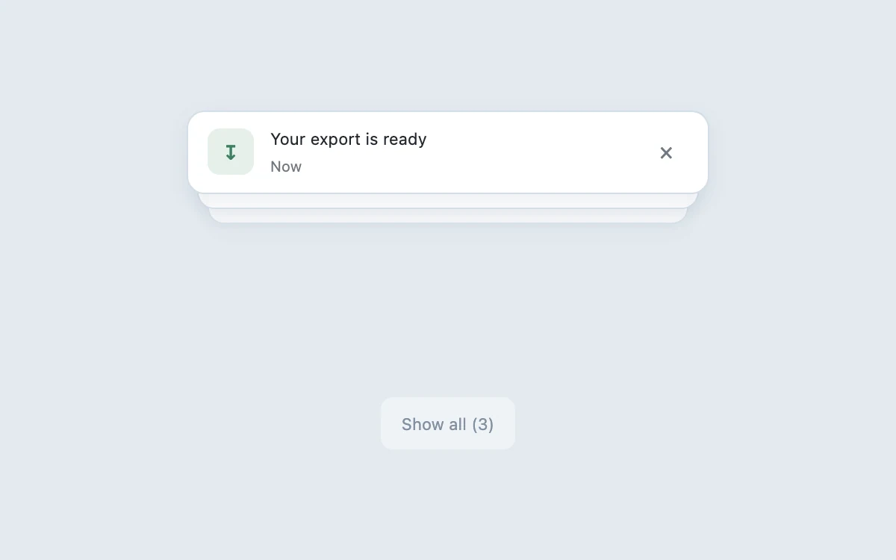

# Notification deck

> Expand stacked notifications without losing their order or origin.

- **Common name:** Stacked toast notifications
- **Category:** Components & interactions
- **Live demo:** https://www.subframe.com/motion/notification-deck
- **Source:** Subframe (original, MIT)
- **Dependencies:** none

## Use case

Expand stacked notifications without losing their order or origin.

## Interaction

Expand the stack or dismiss a notice

## Look

Pale blue-grey page with one white rounded notification card over two peeking cards, a soft green icon tile, and a faint rounded button below.

## Motion

Hovering the deck or pressing the control spreads the cards from 10 px to 60 px offsets, restoring full scale and opacity over 250 ms ease-out; dismissing restacks the rest.

## How to adapt

Each `.notice` gets an inline `transform` from `expanded` (`i * 60` spread, `i * 10` and `1 - i * 0.04` collapsed), eased by its 250 ms CSS transition. Replace the hard-coded `items` strings and their icon and timestamp lookups.

## Reduced motion

Live system preference disables decorative motion; all controls remain usable. Keyboard actions settle immediately.

## Limitations

Local notification stack. Use your application’s notification service for delivery, persistence, and live announcements.

## Taxonomy

- **Components:** notification
- **Triggers:** hover, press
- **Techniques:** slide, scale, fade
- **Feel:** subtle
- **Contexts:** app
- **Tags:** notification, toast, stack, dismiss, expand
- **Also known as:** expandable toast stack, hover expand notifications, notification pile, dismissible toast list
- **Surface color:** `#edf0f3`

## Code

See [`component.tsx`](component.tsx).
