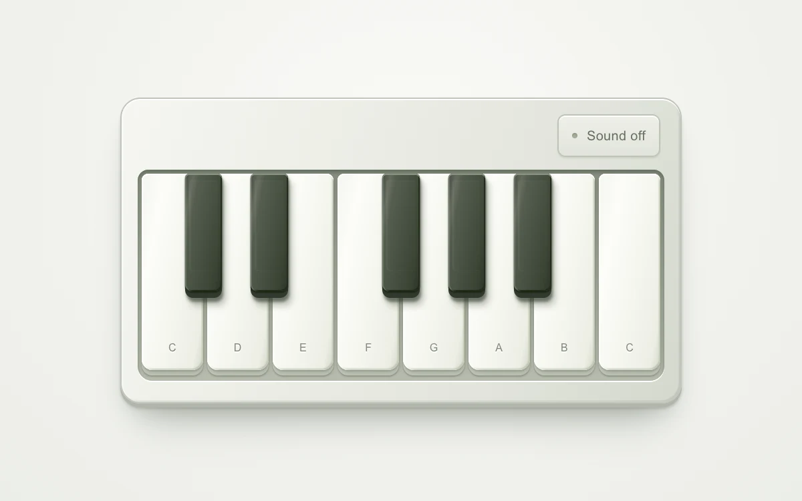

# Octave keys

> A one-octave instrument pairs independently raised key faces with opt-in synthesized notes.

- **Common name:** Piano keyboard
- **Category:** Components & interactions
- **Live demo:** https://www.subframe.com/motion/octave-keys
- **Source:** Subframe (original, MIT)
- **Dependencies:** none

## Use case

Playable instrument previews and audio interfaces with immediate press feedback.

## Interaction

Enable sound, then press a key

## Look

Off-white skeuomorphic keyboard case with an inset keybed of glossy white keys and dark olive sharps, small grey note letters and a toggle button.

## Motion

Pressing a key drops its face 3 px over 110 ms ease-out and fades in an inner shadow; with sound on, each held key plays a triangle-wave note.

## How to adapt

Key travel is CSS: `.sf-octave-key-face` transitions `transform 110ms cubic-bezier(.22,1,.36,1)` to `translateY(3px)` when `data-pressed` is true. Audio lives in `start` and `stop` (triangle oscillator, 15 ms attack, `setTargetAtTime` release); swap `keys` or the waveform for your instrument.

## Reduced motion

Key travel settles instantly. Sound stays explicitly opt-in.

## Limitations

Web Audio triangle oscillators, not sampled piano audio. Browser audio activation requires a user gesture.

## Taxonomy

- **Components:** media, button
- **Triggers:** press, keyboard
- **Techniques:** slide, fade
- **Feel:** refined, playful
- **Contexts:** app, landing
- **Tags:** piano, keyboard, audio, synthesizer, polyphonic, press, instrument
- **Also known as:** playable piano keys, web audio synthesizer, skeuomorphic instrument, musical keyboard component
- **Surface color:** `#f1f2ed`

## Code

See [`component.tsx`](component.tsx).
