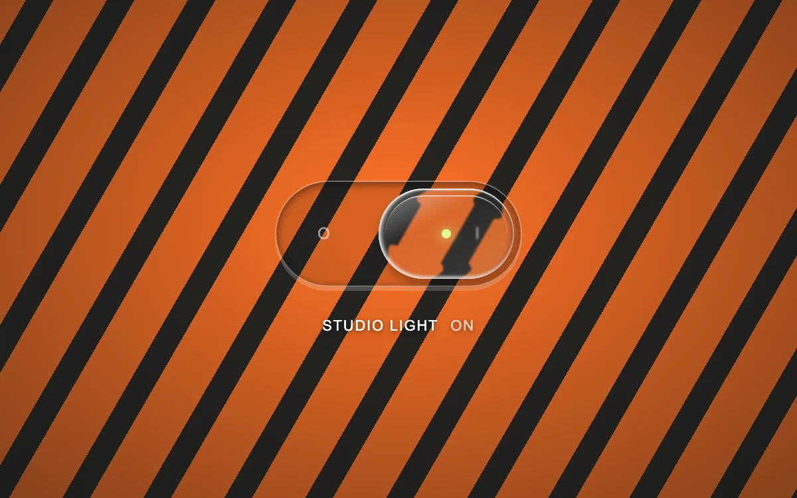

# Optic toggle

> A glass light switch bends the patterned surface beneath its rounded edge.

- **Common name:** Glass toggle switch
- **Category:** Components & interactions
- **Live demo:** https://www.subframe.com/motion/optic-toggle
- **Source:** Subframe (original, MIT)
- **Dependencies:** none

## Use case

Give a familiar on/off control convincing optical depth while preserving native input behavior.

## Interaction

Toggle the studio light.

## Look

A clear glass pill switch with a lensed thumb and lime indicator dot over orange and black diagonal hazard stripes, darkened at the edges.

## Motion

Clicking slides the glass thumb 72 px in 260 ms with an ease-out while its rim refracts the stripes beneath; the striped field brightens or dims over 240 ms.

## How to adapt

Thumb slide and field dimming are CSS on `.ot-thumb` and `.ot-field` keyed by `data-on`; refraction is an `feDisplacementMap` (tune `scale`) over the edge map `measure` draws, Chromium-only via `enhanced`. Replace the striped `.ot-field` backdrop and labels.

## Reduced motion

The switch changes position and illumination immediately.

## Limitations

Rounded-edge SVG backdrop displacement is enhanced in Chromium; other browsers use translucent blur. No optical ray tracing or capture of the page into an image.

## Taxonomy

- **Components:** toggle
- **Triggers:** press, state
- **Techniques:** distortion, slide, blur
- **Feel:** refined, bold
- **Contexts:** app, landing
- **Tags:** glass, refraction, SVG displacement, backdrop filter, switch, optics
- **Also known as:** liquid glass switch, refractive toggle, glassmorphism switch, light switch control
- **Surface color:** `#f76d25`

## Code

See [`component.tsx`](component.tsx).
