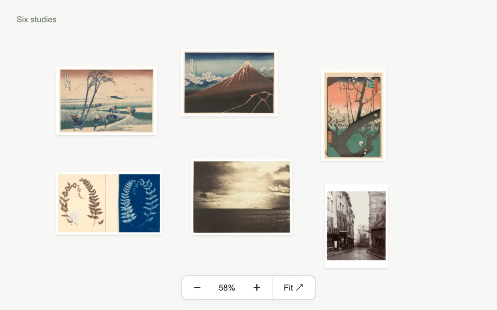

# Orbit atlas

> An open image archive can be panned, fitted, zoomed and brought into focus one work at a time.

- **Common name:** Pan and zoom image canvas
- **Category:** Components & interactions
- **Live demo:** https://www.subframe.com/motion/orbit-atlas
- **Source:** Subframe (original, MIT)
- **Dependencies:** none

## Use case

Explore a spatial collection and inspect an item without losing its surrounding arrangement.

## Interaction

Drag the canvas, zoom or choose a work.

## Look

Off-white board holding six white-bordered prints (woodblock landscapes, a fern cyanotype, sepia photographs) loosely arranged above a floating white zoom toolbar.

## Motion

Clicking a work glides the board to centre and enlarge it over 0.32 s ease-out; dragging pans 1:1 without easing, and the zoom and fit buttons animate the same transform.

## How to adapt

The camera is `view` (x, y, zoom) applied to `oa-world` as translate plus scale with a 0.32 s `cubic-bezier(.22,1,.36,1)` transition; `focus`, `fit` and `bounded` set targets and limits. Replace `specimens` positions and images with your own layout.

## Reduced motion

The camera moves immediately between views; all pan, zoom and selection controls remain.

## Limitations

Six works in a bounded board. It intentionally does not create an infinite or automatically populated canvas.

## Taxonomy

- **Components:** gallery, editor
- **Triggers:** drag, press, keyboard
- **Techniques:** scale, slide
- **Feel:** subtle, refined
- **Contexts:** editorial, app
- **Tags:** spatial canvas, pan, zoom, image collection, focus
- **Also known as:** zoomable moodboard, spatial image board, click to zoom gallery, draggable canvas gallery
- **Surface color:** `#f2f0e9`

## Assets

- [`fern-diptych.webp`](../../assets/fern-diptych.webp) — Untitled (Fern Study), c. 1850, from the Hatton Fern Album (CC0-1.0)
- [`fuji-storm.webp`](../../assets/fuji-storm.webp) — Shower Below the Summit (Sanka hakuu), from the series "Thirty-Six Views of Mount Fuji (Fugaku sanjurokkei)" (CC0-1.0)
- [`mediterranean-clouds.webp`](../../assets/mediterranean-clouds.webp) — Cloudy Sky, Mediterranean Sea (CC0-1.0)
- [`paris-street.webp`](../../assets/paris-street.webp) — Rue de la Montagne-Sainte-Geneviève near the Intersection of Rue LaPlace (Rue de la Montagne-Sainte-Geneviève prés de carrefour de la rue LaPlace) (CC0-1.0)
- [`plum-garden.webp`](../../assets/plum-garden.webp) — Plum Garden at Kameido (Kameido Umeyashiki), from the series "One Hundred Famous Views of Edo (Meisho Edo hyakkei)" (CC0-1.0)
- [`suruga-wind.webp`](../../assets/suruga-wind.webp) — Ejiri in Suruga Province (Sunshu Ejiri), from the series "Thirty-six Views of Mount Fuji (Fugaku sanjurokkei)" (CC0-1.0)

## Code

See [`component.tsx`](component.tsx).
