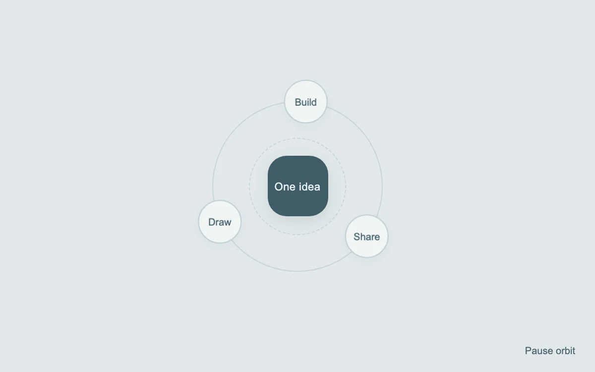

# Connected in orbit

> Three labels circle one idea while staying upright.

- **Common name:** Orbiting circles diagram
- **Category:** Animation & motion
- **Live demo:** https://www.subframe.com/motion/orbiting-circles
- **Source:** Magic UI (adapted, MIT) — https://magicui.design/docs/components/orbiting-circles · [original code](https://github.com/magicuidesign/magicui/blob/85f97fd27b053339af74ba9dd4ca428ee25989fb/apps/www/registry/magicui/orbiting-circles.tsx)
- **Dependencies:** none

## Use case

Illustrate a small set of related tools, stages or capabilities.

## Interaction

Play or pause the orbit

## Look

Pale blue-grey field with a dark slate rounded-square hub, solid and dashed concentric rings, and three small white circle labels on the outer ring.

## Motion

Three labels revolve around the hub once every 24 s at constant linear speed, counter-rotating so their text stays upright; a button pauses the orbit.

## How to adapt

The orbit is the `mg-orbit-travel` keyframes (`rotate(var(--angle)) translateY(86px)` then counter-rotate) at `24s linear infinite`; each item's start `--angle` is `i * 120 + 60`. Replace `items` and the centre label, changing `86px` in both places to set the radius.

## Reduced motion

All labels remain at fixed, evenly spaced positions.

## Limitations

This is an illustrative diagram, not interactive navigation. Keep labels short and preserve the accessible description.

## Taxonomy

- **Components:** scene
- **Triggers:** ambient
- **Techniques:** rotate, loop
- **Feel:** calm, subtle
- **Contexts:** landing
- **Tags:** orbit, rotation, counter rotation, diagram, relationship, loop
- **Also known as:** integrations orbit, icons orbiting a logo, revolving satellite labels, solar system animation
- **Surface color:** `#e1e8ea`

## Code

See [`component.tsx`](component.tsx).
