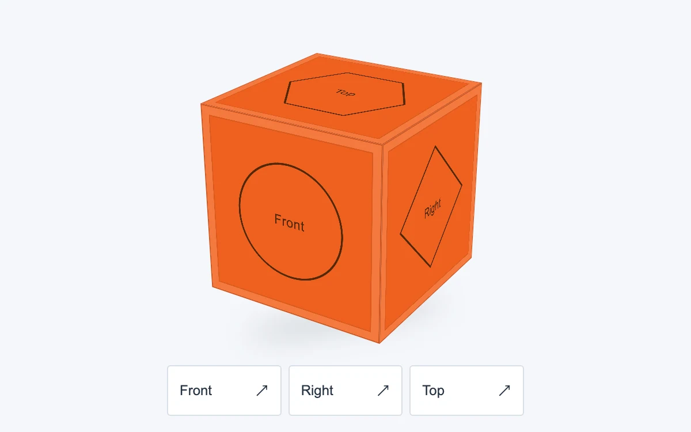

# Orientation cube

> A ceramic orange cube orbits under the pointer and snaps to named faces.

- **Common name:** Draggable 3D cube
- **Category:** Components & interactions
- **Live demo:** https://www.subframe.com/motion/orientation-cube
- **Source:** Subframe (original, MIT)
- **Dependencies:** none

## Use case

Spatial orientation controls and small product or object inspectors.

## Interaction

Drag the cube, use arrow keys, or choose a face

## Look

Pale grey-blue page with a matte orange cube whose faces carry thin outlined shapes and labels, a soft floor shadow and three white buttons.

## Motion

Dragging orbits the cube directly at 0.65° per pixel, pitch clamped to ±90°; face buttons turn it to that face by the shortest path over 500 ms, ease-out.

## How to adapt

The cube is CSS `preserve-3d`: `angle` drives `rotateX(${angle.x}deg) rotateY(${angle.y}deg)` on `sf-orientation-cube`, eased by `transition:transform 500ms cubic-bezier(.22,1,.36,1)` unless `data-instant` is set. Replace the `CUBE_FACES` artwork and the `faces` snap targets; drag sensitivity is the 0.65 factor.

## Reduced motion

Face changes settle immediately. Direct pointer and keyboard rotation remain available.

## Limitations

CSS six-face object, not a mesh renderer or twisty-puzzle simulator.

## Taxonomy

- **Components:** scene, editor
- **Triggers:** drag, press, keyboard
- **Techniques:** 3d, rotate
- **Feel:** technical, playful
- **Contexts:** app
- **Tags:** css-3d, cube, orbit, drag, perspective, orientation, snap
- **Also known as:** view cube navigator, CSS 3D cube, orbit control, 3D orientation gizmo
- **Surface color:** `#f5f7fa`

## Code

See [`component.tsx`](component.tsx).
