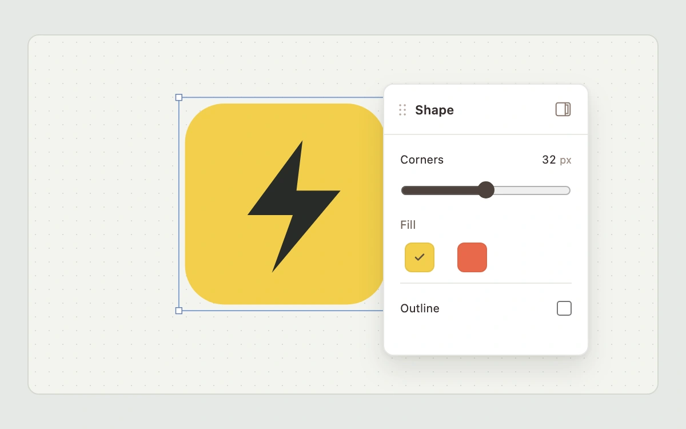

# Dock, detach, return

> A floating shape inspector previews edge docking and returns to its previous position without losing its properties.

- **Common name:** Dockable inspector panel
- **Category:** Components & interactions
- **Live demo:** https://www.subframe.com/motion/panel-docking
- **Source:** Subframe (original, MIT)
- **Dependencies:** none

## Use case

Reclaim canvas space while keeping inspector state and keyboard focus intact.

## Interaction

Drag the title to an allowed edge, use the dock buttons, or move with arrow keys. Detach restores the prior floating position.

## Look

Neutral dotted drafting canvas, a yellow or vermilion lightning icon, and one compact white inspector with a title grip and edge-dock buttons.

## Motion

The inspector tracks the title drag directly; a pale target marks an eligible edge. Release settles its transform over 180 ms, while the canvas reserves the docked width. Detach restores the last free position.

## How to adapt

`mode`, `position` and `lastFree` keep docking separate from `radius`, `fill` and `stroke`. `cancel` restores the drag snapshot. Override `DEFAULT_CONFIG` through the `config` prop; inputs remain mounted across dock transitions.

## Reduced motion

Panel transforms settle immediately for keyboard input, reduced motion and inactive hosts. Host pause and pointer cancellation restore the pre-drag state.

## Limitations

One inspector and one original lightning icon. Docking is local component state, not a general window manager. The inspector changes corner radius, fill and outline; editor configuration controls docking behavior separately.

## Taxonomy

- **Components:** editor, card, slider, toggle
- **Triggers:** drag, press, keyboard, state
- **Techniques:** slide, layout
- **Feel:** refined, technical
- **Contexts:** app, dashboard
- **Tags:** panel, docking, inspector, workspace, drag, layout, floating, properties
- **Also known as:** floating properties panel, drag to dock, workspace inspector, detachable panel
- **Surface color:** `#e7e9e5`

## Code

See [`component.tsx`](component.tsx).
