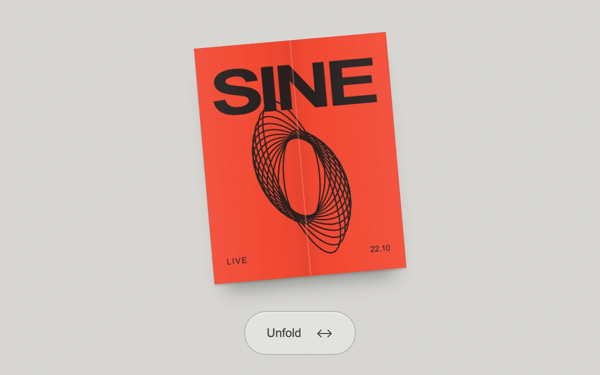

# Sine gatefold

> Two printed cover flaps unfold around real hinges to reveal a continuous concert-edition artwork.

- **Common name:** Paper unfold reveal
- **Category:** Animation & motion
- **Live demo:** https://www.subframe.com/motion/paper-fold
- **Source:** Subframe (original, MIT)
- **Dependencies:** none

## Use case

Reveal an invitation, printed edition or product insert through its actual folded structure.

## Interaction

Unfold the invitation

## Look

Pale grey surface with a slightly tilted red-orange folded print bearing bold black type and overlapping line ellipses, above a pill-shaped grey button.

## Motion

Pressing the print or button swings both cover flaps open on their hinges (rotateY ±180° to 0, 720 ms ease-out), revealing the inner spread as creases soften.

## How to adapt

The fold is CSS: `.pf-left` and `.pf-right` rotate on edge `transform-origin` inside a `preserve-3d` `.pf-print`, with `backface-visibility` showing `.pf-cover` or `.pf-inner`; timing is `720ms cubic-bezier(.25,.75,.2,1)`. Replace the `InnerPrint` and `CoverPrint` artwork, split across panels by `offset`.

## Reduced motion

Open and closed states change immediately, preserving the full printed artwork and native controls.

## Limitations

Authored rigid CSS panels and paper shadows, not a soft-body paper simulation. Sine is an original fictional concert edition; the printed date is demo content.

## Taxonomy

- **Components:** card, scene
- **Triggers:** press
- **Techniques:** 3d, rotate
- **Feel:** refined
- **Contexts:** editorial, landing
- **Tags:** paper, fold, gatefold, invitation, 3d, hinge, print, reveal, backface
- **Also known as:** gatefold card, folding invitation, 3D card unfold, fold-out brochure
- **Surface color:** `#d7d6d2`

## Code

See [`component.tsx`](component.tsx).
