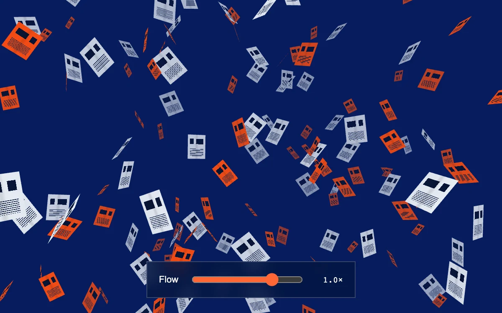

# Paper swarm

> Printed sheets tumble through a deep blue volume in a single instanced draw call.

- **Common name:** 3D floating paper particles
- **Category:** WebGL & shaders
- **Live demo:** https://www.subframe.com/motion/paper-swarm
- **Source:** Subframe (original, MIT)
- **Dependencies:** none

## Use case

An ambient field for an archive, publishing identity, or editorial transition.

## Interaction

Move the pointer for parallax; change or reverse the flow

## Look

Saturated royal-blue field scattered with angled orange and pale-grey printed sheets showing dark headline blocks and text lines, plus a translucent slider bar.

## Motion

150 printed sheets spin, roll and rise endlessly through a 3D volume at varied speeds; pointer movement eases the camera for parallax, and a slider speeds or reverses the flow.

## How to adapt

Motion lives in `vertexSource`: per-sheet `angle`, `roll` and vertical drift all scale with `time`; `sheets` seeds 150 instance positions and `render` eases `cameraX`/`cameraY` toward the pointer. Restyle the printed sheets in `fragmentSource`; keep the static fallback.

## Reduced motion

The volume holds one frame and pointer parallax stops.

## Limitations

Requires WebGL2; a static CSS paper composition appears if unavailable or the context is lost. 150 deterministic instances; the display-aware drawing buffer is capped at 3.6 million pixels. Remount to recover a lost context.

## Taxonomy

- **Components:** background, scene
- **Triggers:** ambient, pointer
- **Techniques:** shader, 3d, particles, parallax
- **Feel:** bold, playful
- **Contexts:** landing, editorial
- **Tags:** WebGL2, instancing, particles, paper, 3D, parallax, planes, swarm, loop
- **Also known as:** floating documents background, flying paper animation, tumbling sheets hero, document particles
- **Surface color:** `#061c5e`

## Code

See [`component.tsx`](component.tsx).
