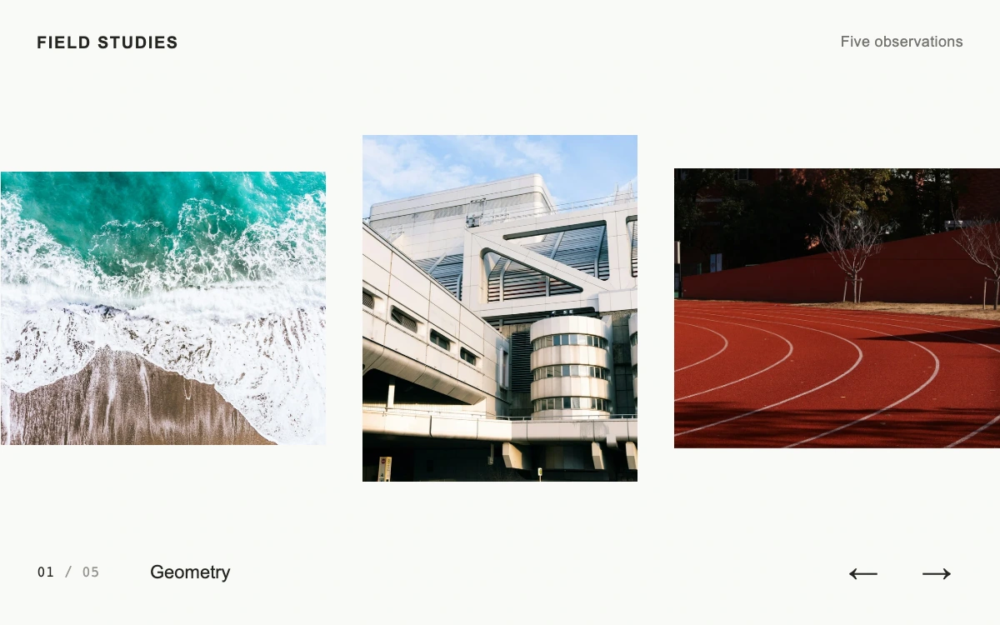

# Parallax plates

> Photographic plates move through a continuous rail while bounded image crops shift within fully covered frames.

- **Common name:** Parallax image carousel
- **Category:** Animation & motion
- **Live demo:** https://www.subframe.com/motion/parallax-plates
- **Source:** Subframe (original, MIT)
- **Dependencies:** none

## Use case

Browse an editorial photo collection with depth provided by the photography and its relative motion.

## Interaction

Drag or swipe the rail; use Previous, Next or keyboard arrows to center an image.

## Look

Off-white page with a horizontal rail of varied-size photographs (surf, white concrete architecture, red running track), a small spaced-caps header and a monospace counter.

## Motion

Dragging throws a wrapping rail with decaying inertia, then a 380 ms cubic ease-out centres the nearest plate; each photo shifts inside its frame against the motion.

## How to adapt

`render` positions each plate from `offset` via `wrap` and sets the image parallax (`-x * 0.065`, clamped to 13% of width); `coast` handles inertia decay and `settle` the 380 ms snap. Replace `PLATES` with your images and sizes.

## Reduced motion

Dragging remains direct; navigation and release settle immediately without inertia. Host pause cancels the active animation and disables controls.

## Limitations

Five local photographs; no video playback or data fetching. Crops use 130% image width with a bounded 13% frame-width shift. Photographs retain separate Unsplash terms.

## Taxonomy

- **Components:** gallery
- **Triggers:** drag, press, keyboard
- **Techniques:** parallax, physics, loop
- **Feel:** refined
- **Contexts:** editorial, landing
- **Tags:** carousel, parallax, photography, drag, inertia, wrap, gallery, image coverage
- **Also known as:** draggable image carousel, infinite photo slider, momentum carousel, swipe gallery, parallax slider
- **Surface color:** `#f 9f 9f 7`

## Assets

- [`concrete-geometries.webp`](../../assets/concrete-geometries.webp) — Angular white concrete architecture (Unsplash)
- [`running-track.webp`](../../assets/running-track.webp) — Red curved running lanes (Unsplash)
- [`coastal-break.webp`](../../assets/coastal-break.webp) — Turquoise surf on ochre rocks (Unsplash)
- [`concrete-projections.webp`](../../assets/concrete-projections.webp) — Projecting concrete building forms (Unsplash)
- [`blue-tide.webp`](../../assets/blue-tide.webp) — White foam across blue water (Unsplash)

## Code

See [`component.tsx`](component.tsx).
