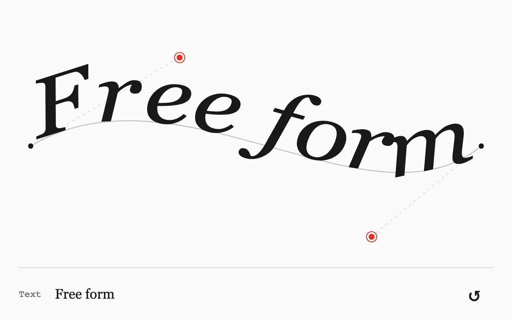

# Path typesetter

> Editable type stretches across a cubic curve with two direct manipulation handles.

- **Common name:** Text on a curved path
- **Category:** Animation & motion
- **Live demo:** https://www.subframe.com/motion/path-typesetter
- **Source:** Subframe (original, MIT)
- **Dependencies:** none

## Use case

Shape a short typographic phrase while preserving its reading order.

## Interaction

Drag a bend or edit the text.

## Look

Black serif italic phrase riding a thin grey curve on off-white, with two red bezier handles on dashed guides and a ruled text field below.

## Motion

Dragging either red handle reshapes the cubic curve and the text re-flows along it, stretching letter spacing and glyphs to fill the new length; arrow keys nudge handles.

## How to adapt

The curve is the `d` string built from `points`, and `curveLength` feeds `textLength` so `lengthAdjust` stretches glyphs to fit. Tune `bound` and the `initial` handle positions; replace the default `text` state and the Georgia font settings.

## Reduced motion

All edits are immediate; no autonomous animation.

## Limitations

A short, single-line phrase up to 18 characters. SVG textPath metrics vary with available Georgia font metrics.

## Taxonomy

- **Components:** text, editor
- **Triggers:** drag, keyboard
- **Techniques:** path
- **Feel:** refined, technical
- **Contexts:** editorial, app
- **Tags:** svg, text path, curved type, editable typography, bezier, typography, direct manipulation
- **Also known as:** curved text editor, bezier text warp, SVG textPath, wavy headline, arched type tool
- **Surface color:** `#fafafa`

## Code

See [`component.tsx`](component.tsx).
