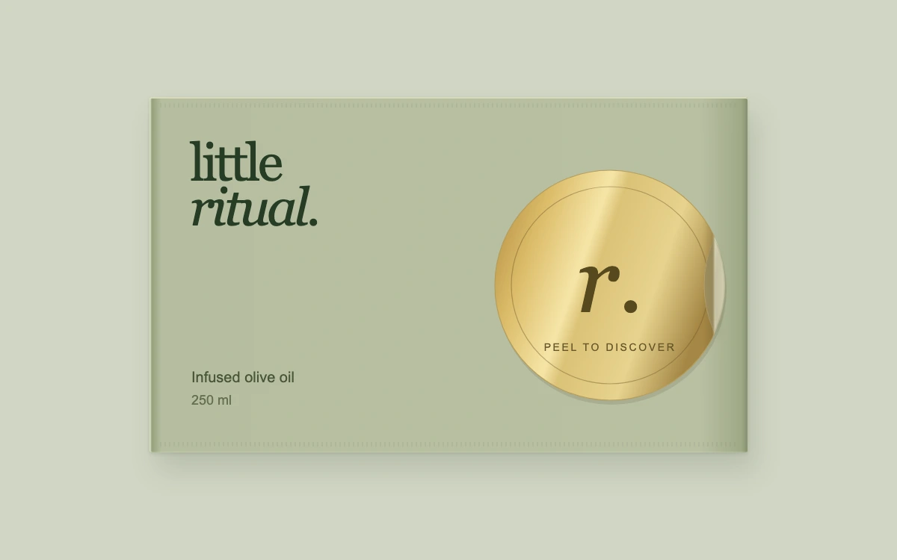

# Secret ingredient

> A gold foil seal peels across a moving crease to reveal the basil beneath.

- **Common name:** Peel-off sticker reveal
- **Category:** Animation & motion
- **Live demo:** https://www.subframe.com/motion/peel-sticker
- **Source:** Subframe (original, MIT)
- **Dependencies:** none

## Use case

Make a deliberate ingredient, offer or membership reveal feel tactile without obscuring the revealed content.

## Interaction

Peel the foil, then press either the foil reverse or exposed seal area to reseal.

## Look

Sage-green packet with a dark green serif wordmark and a round metallic gold foil seal bearing an italic monogram, on a pale sage background.

## Motion

Clicking sweeps a vertical crease right to left across the seal over 560 ms (cubic ease-out), folding back a mirrored pale reverse to uncover the ingredient; clicking again reseals.

## How to adapt

A `requestAnimationFrame` tween in the effect drives `progress`, and `fold` maps it to the crease position used by the clip rects, mirrored reverse and crease gradient. Tune `duration` there; replace the packet copy, `ps-ingredient` artwork and the seal monogram.

## Reduced motion

The seal changes state immediately for keyboard and reduced motion. Host pause freezes an in-progress fold and resumes its existing target when reactivated.

## Limitations

A bounded SVG fold with a rigid mirrored reverse and authored lighting; not a soft-body paper simulation. All packaging and ingredient artwork is original fictional content.

## Taxonomy

- **Components:** scene, image
- **Triggers:** press
- **Techniques:** mask, rotate
- **Feel:** playful, refined
- **Contexts:** landing, app
- **Tags:** peel, sticker, fold, packaging, reveal, foil, crease, SVG
- **Also known as:** sticker peel effect, peel to reveal, fold-over reveal, foil seal reveal
- **Surface color:** `#d 1d 6c 5`

## Code

See [`component.tsx`](component.tsx).
