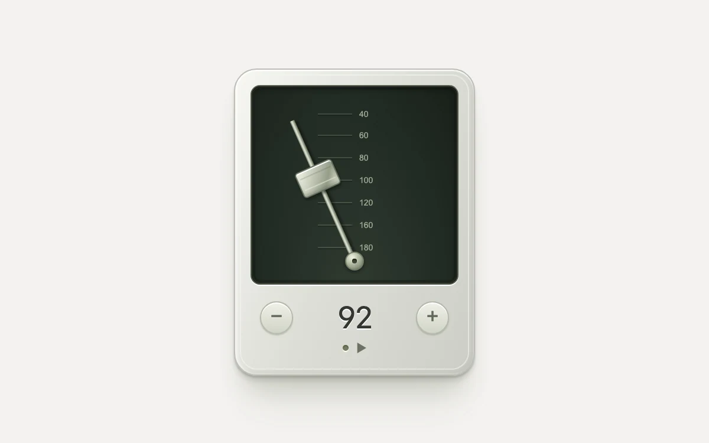

# Pendulum tempo

> A metal pendulum and sliding counterweight make an adjustable beat visible.

- **Common name:** Pendulum metronome
- **Category:** Animation & motion
- **Live demo:** https://www.subframe.com/motion/pendulum-tempo
- **Source:** Subframe (original, MIT)
- **Dependencies:** none

## Use case

A visual tempo reference for rehearsing timing or motion cadence.

## Interaction

Start the pendulum and change its tempo

## Look

Skeuomorphic pale-metal device with soft bevels and a dark green recessed face holding a silver pendulum, tempo scale and counterweight, above round plus-minus buttons.

## Motion

Pressing play swings the arm ±24° in an infinite ease-in-out loop, one swing per beat; the tempo buttons step 4 BPM, retiming the cycle and sliding the weight.

## How to adapt

The swing is the `sf-tempo-swing` keyframes on `sf-tempo-arm`, timed by `--period` (`120 / bpm` seconds) with `cubic-bezier(.37,0,.63,1)` and toggled via `data-running`; `--weight-position` maps `bpm` to the weight. Adjust the 40–180 range and tick labels together.

## Reduced motion

The pendulum stays upright; tempo controls remain available.

## Limitations

Visual-only tempo; no audio click or sample-accurate clock. Changing tempo retimes the CSS cycle and may shift its phase.

## Taxonomy

- **Components:** media, scene
- **Triggers:** press, ambient
- **Techniques:** rotate, loop
- **Feel:** refined, calm
- **Contexts:** app
- **Tags:** pendulum, tempo, beat, metronome, rhythm, metal, kinetic
- **Also known as:** metronome, BPM indicator, swinging pendulum, tempo visualizer
- **Surface color:** `#f3f2ef`

## Code

See [`component.tsx`](component.tsx).
