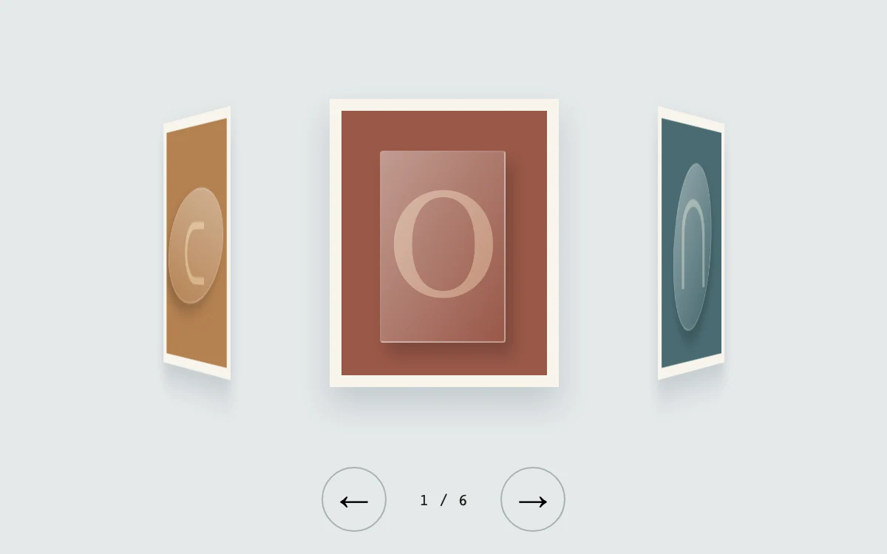

# Turntable studies

> A ring of framed compositions rotates through a spatial collection.

- **Common name:** 3D ring carousel
- **Category:** Animation & motion
- **Live demo:** https://www.subframe.com/motion/perspective-carousel
- **Source:** Subframe (original, MIT)
- **Dependencies:** none

## Use case

Browse a short visual collection while preserving the placement of neighbouring items.

## Interaction

Turn the collection

## Look

Pale grey-blue page with cream-framed muted terracotta, teal and ochre art panels on a 3D ring, glassy serif glyphs, and round outlined arrow buttons.

## Motion

Arrow buttons rotate the six-panel ring 60° around its vertical axis in perspective over 0.7 s with a soft ease-out, side panels receding at an angle.

## How to adapt

Each `panel` sits at a 60° `rotateY` step and `translateZ(220px)`; `ring` turns by `index` with a 0.7 s `cubic-bezier(.2,.8,.2,1)` transition under `perspective:850px`. Replace `colors` and glyphs with images, retuning 60° and 220px for other counts.

## Reduced motion

Live reduced-motion preferences remove interpolation and decorative playback. All content and native controls remain available. Keyboard changes settle immediately.

## Limitations

Original demonstration content; adapt labels and state to the host product.

## Taxonomy

- **Components:** gallery
- **Triggers:** press
- **Techniques:** 3d, rotate
- **Feel:** refined
- **Contexts:** landing, editorial
- **Tags:** carousel, 3D, ring, gallery, perspective
- **Also known as:** cylinder carousel, rotating 3D gallery, CSS 3D carousel, carousel with perspective
- **Surface color:** `#e4e8ea`

## Code

See [`component.tsx`](component.tsx).
