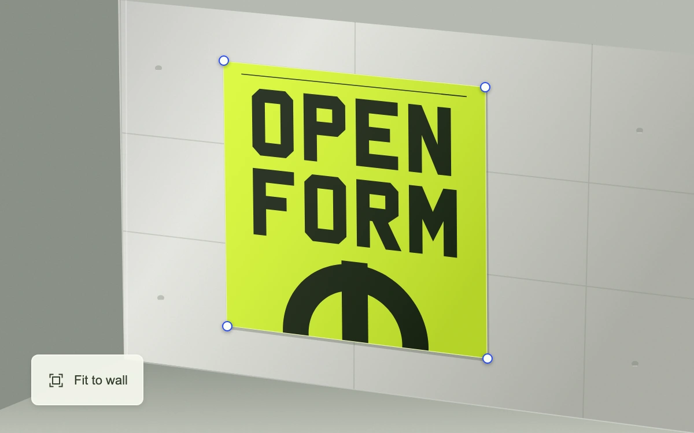

# Poster corner pin

> Four corner handles project an original fluorescent poster onto an oblique concrete wall, with one action to restore its fit.

- **Common name:** Image perspective warp
- **Category:** Components & interactions
- **Live demo:** https://www.subframe.com/motion/perspective-pin
- **Source:** Subframe (original, MIT)
- **Dependencies:** none

## Use case

Place vector artwork on a photographed or rendered surface using direct corner manipulation rather than matrix fields.

## Interaction

Drag a poster corner, nudge it with arrow keys, or choose Fit to wall.

## Look

Pale concrete wall in oblique perspective with a fluorescent yellow-green poster of heavy black block letters, small blue-ringed corner handles and a frosted fit button.

## Motion

Dragging or arrow-nudging a corner handle re-projects the whole poster through a four-point homography on every move, clamped to stay convex; the fit button restores it instantly.

## How to adapt

`matrix` solves the homography from `points`; `project` and `path` map poster-space shapes, clipped by `clipArtwork`; `moveCorner` clamps each corner to a fixed box and keeps the quad convex. Replace `wall`, `fitted` and the `glyphs` artwork, then retune those boxes.

## Reduced motion

Corner edits follow input directly. Fit to wall restores the exact target geometry without an animated warp.

## Limitations

Bounded corner movement also enforces a positive signed-turn margin to prevent concave, self-crossing or nearly collapsed quadrilaterals. Wall and poster are original SVG, including outlined lettering. No image upload or camera calibration.

## Taxonomy

- **Components:** image, editor
- **Triggers:** drag, keyboard
- **Techniques:** distortion, 3d
- **Feel:** technical
- **Contexts:** app
- **Tags:** perspective, corner pin, projective, homography, warp, poster, projection mapping, SVG, editor
- **Also known as:** four-point perspective warp, distort transform handles, mockup placement tool, homography warp, free transform
- **Surface color:** `#c2c5b9`

## Code

See [`component.tsx`](component.tsx).
