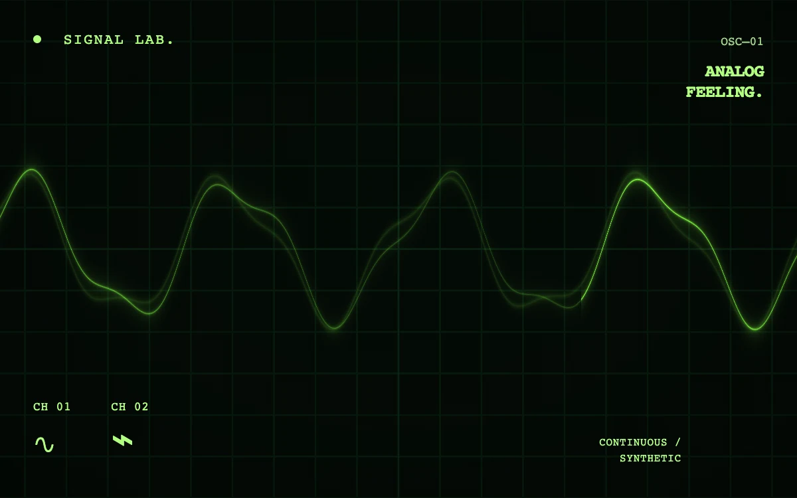

# Phosphor trace

> A synthetic waveform sweeps across phosphor green gridwork with a restrained afterglow.

- **Common name:** Oscilloscope CRT shader
- **Category:** WebGL & shaders
- **Live demo:** https://www.subframe.com/motion/phosphor-trace
- **Source:** Subframe (original, MIT)
- **Dependencies:** none

## Use case

Audio tools, signal-processing products, experimental music releases, or a technical brand texture.

## Interaction

Play or pause the material study.

## Look

Near-black green CRT screen with a faint ruled grid, a glowing lime waveform with soft ghost trails, scanline texture, vignette and small monospace labels.

## Motion

A two-sine waveform drifts continuously across the grid with a faint 0.2 s afterimage, while a brightness sweep scans left to right about every 6.7 s.

## How to adapt

The waveform is `trace` in `FRAGMENT` (two sines; edit amplitudes and frequencies), with `ghost` for the afterglow, `sweep` for the scan and `grid` for the graticule; recolour via `vec3(.52,1.0,.24)`. Replace the monospace label spans with your own copy.

## Reduced motion

Displays one stable, representative frame. Responds immediately when the system preference changes.

## Limitations

Requires WebGL 1; a static CSS composition remains visible when WebGL is unavailable or lost. This is a synthetic decorative signal, not an audio visualizer or live measurement.

## Taxonomy

- **Components:** background, media
- **Triggers:** ambient
- **Techniques:** shader, glow
- **Feel:** technical
- **Contexts:** landing, editorial
- **Tags:** oscilloscope, phosphor, crt, waveform, audio, signal, green, technical, native webgl
- **Also known as:** green phosphor waveform, retro CRT display, analog signal background, audio waveform hero
- **Surface color:** `#06110b`

## Code

See [`component.tsx`](component.tsx).
