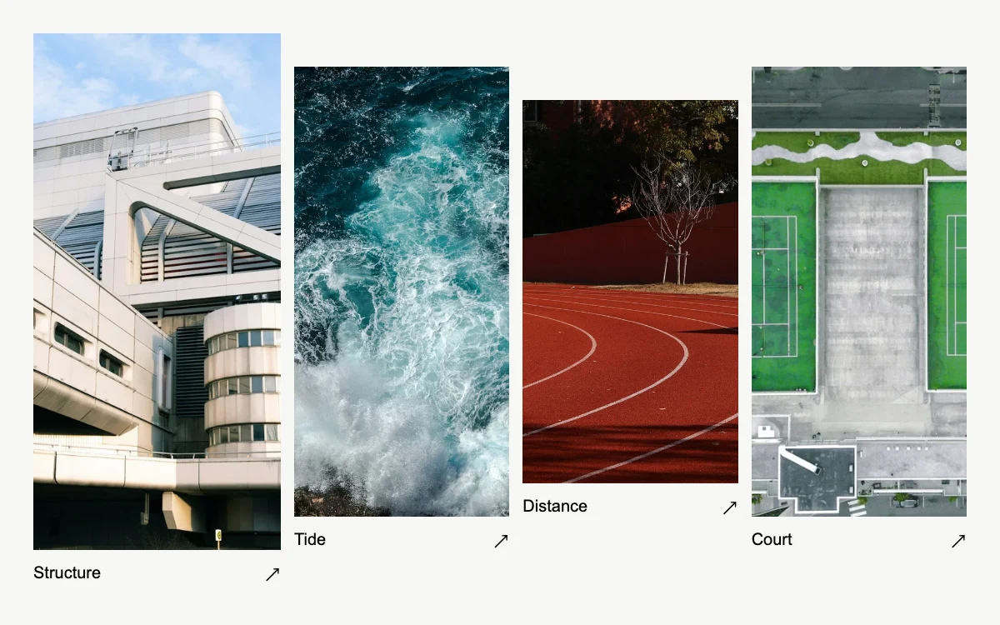

# Photo lightbox

> An austere photographic index opens a dark, contained viewer with thumbnails, bounded zoom and pan.

- **Common name:** Image lightbox with zoom
- **Category:** Components & interactions
- **Live demo:** https://www.subframe.com/motion/photo-lightbox
- **Source:** Subframe (original, MIT)
- **Dependencies:** none

## Use case

Inspect a photograph closely without losing its collection context.

## Interaction

Open a photograph; browse, enlarge and drag. Arrow keys browse or pan the enlarged image.

## Look

Off-white page with a row of four tall, staggered-height photographs (architecture, surf, running track, tennis courts), each with a small caption and arrow.

## Motion

Selecting a photo opens a dark viewer instantly; enlarging jumps the image to 1.7× for drag or arrow-key panning within clamped bounds, and fitting eases it back over 240 ms.

## How to adapt

Zoom and pan are one inline `transform` on the viewer image (`scale(${zoom ? 1.7 : 1})` plus `pan`), bounded by `clampPan`; fitting eases via the `.pl-view img` transition `.24s cubic-bezier(.2,.8,.2,1)`. Replace `PHOTOS`; the dialog is scoped to the component, not the page.

## Reduced motion

The viewer opens immediately and fit-to-image changes skip interpolation.

## Limitations

The viewer is scoped to its component bounds, not a page-level modal. Photographs have separate Unsplash terms.

## Taxonomy

- **Components:** dialog, gallery, image
- **Triggers:** press, drag, keyboard
- **Techniques:** scale
- **Feel:** subtle, refined
- **Contexts:** app, editorial
- **Tags:** photography, lightbox, gallery, zoom, pan, focus, dialog
- **Also known as:** image viewer modal, photo zoom and pan, fullscreen gallery viewer, image modal with thumbnails, click to enlarge photo
- **Surface color:** `#f7f7f4`

## Assets

- [`concrete-geometries.webp`](../../assets/concrete-geometries.webp) — Angular white concrete architecture (Unsplash)
- [`coastal-break.webp`](../../assets/coastal-break.webp) — Turquoise surf on ochre rocks (Unsplash)
- [`running-track.webp`](../../assets/running-track.webp) — Red curved running lanes (Unsplash)
- [`tennis-court.webp`](../../assets/tennis-court.webp) — Green tennis courts from above (Unsplash)

## Code

See [`component.tsx`](component.tsx).
