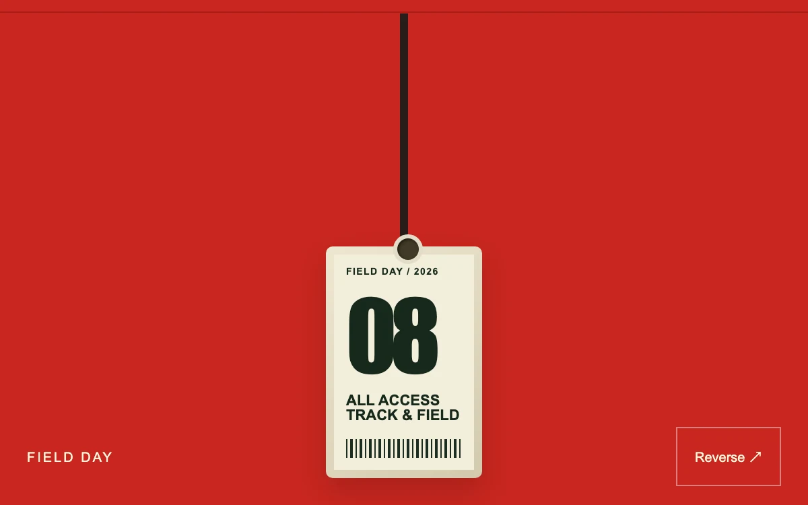

# Pinned pass

> A numbered athletics pass swings from a constrained cord and keeps its weight when released.

- **Common name:** Physics lanyard badge
- **Category:** Animation & motion
- **Live demo:** https://www.subframe.com/motion/pinned-pass
- **Source:** Subframe (original, MIT)
- **Dependencies:** none

## Use case

Add direct manipulation to a small event credential or collectible.

## Interaction

Drag the pass and release.

## Look

Bright red field with a dark cord hanging from a top rail to a cream event badge with grommet, huge condensed numeral and barcode stripes.

## Motion

A nine-point Verlet cord with gravity and damping swings the badge, which tilts with the last segment (±42°); dragging pins the cord's end, and release lets it sway to rest.

## How to adapt

Physics is `simulate`: Verlet integration (0.973 damping, 0.22 gravity) and 12 constraint passes over nine `knots`, stepped at 60 Hz by `frame` for 220 steps after release; `draw` maps the last segment to the card's rotation. Replace the `.pp-inner` badge content.

## Reduced motion

The pass follows deliberate input without inertial playback; arrow keys place it immediately.

## Limitations

A two-dimensional constrained cord and rigid card with approximate rotation; no cloth, collision or metal shading engine.

## Taxonomy

- **Components:** card, scene
- **Triggers:** drag, keyboard
- **Techniques:** physics, rotate
- **Feel:** playful
- **Contexts:** landing
- **Tags:** lanyard, Verlet, constraints, drag, physics, badge
- **Also known as:** lanyard card, hanging badge, swinging ID card, rope physics card
- **Surface color:** `#c92720`

## Code

See [`component.tsx`](component.tsx).
