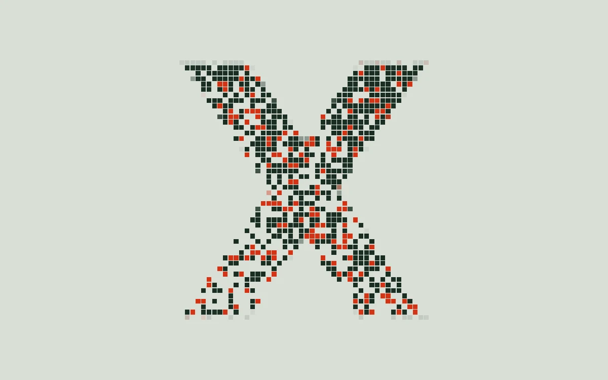

# Pixel dissolve

> A sculptural monogram breaks into a precise, staggered field of square pixels.

- **Common name:** Pixelated logo reveal
- **Category:** WebGL & shaders
- **Live demo:** https://www.subframe.com/motion/pixel-dissolve
- **Source:** Subframe (original, MIT)
- **Dependencies:** none

## Use case

Reveal marks or section artwork with a controlled digital disintegration.

## Interaction

Adjust dissolve

## Look

Pale sage-grey field with a large X monogram of small dark-green square pixels, partly dissolved, with vermilion pixels marking the dissolving edge.

## Motion

Mark pixels vanish bottom-first in a random stagger and return as a threshold cycles on a ~20 s sine; red pixels mark the front and the slider offsets it.

## How to adapt

The dissolve is the `FRAGMENT` shader: `70.0` sets the pixel grid, `mark` is the monogram mask, `cycle` the timing, and `rank` the random-plus-vertical ordering that `threshold` cuts. Replace `mark` with your logo's mask; keep the WebGL lifecycle and reduced-motion branch.

## Reduced motion

A representative frame remains still. Live system preference changes immediately stop the loop; the range control continues to update the still image.

## Limitations

Requires WebGL 1. A static CSS fallback appears when unavailable or after context loss. No image is downloaded. The dissolve is a reversible ambient study rather than an entrance completion callback.

## Taxonomy

- **Components:** image, background
- **Triggers:** ambient, state
- **Techniques:** shader, noise, mask
- **Feel:** technical, bold
- **Contexts:** landing, editorial
- **Tags:** pixel, dissolve, threshold, stochastic, reveal, native webgl
- **Also known as:** pixel disintegration, dissolve transition, pixelated fade, random pixel reveal, digital decay logo
- **Surface color:** `#dadfd9`

## Code

See [`component.tsx`](component.tsx).
