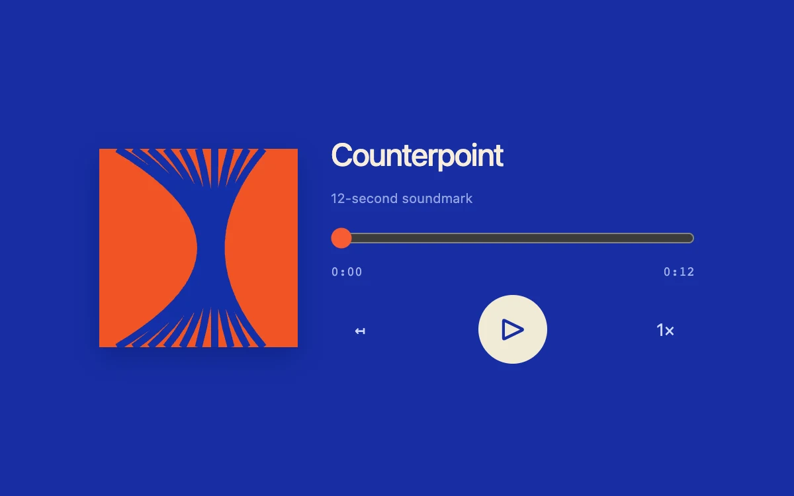

# Pocket player

> A cobalt audio sleeve pairs an original soundmark with synchronized seek, transport and playback speed.

- **Common name:** Audio player
- **Category:** Components & interactions
- **Live demo:** https://www.subframe.com/motion/pocket-player
- **Source:** Subframe (original, MIT)
- **Dependencies:** none

## Use case

Preview an audio artifact in a compact embedded card.

## Interaction

Play the soundmark, seek, restart or change speed.

## Look

Cobalt-blue field with a square orange cover of curved blue lines, cream sans-serif title, thin seek bar and a round cream play button.

## Motion

Nothing animates decoratively: during playback the audio's time updates advance the native range thumb and clock; play swaps to a pause glyph and speed cycles 1×, 1.5×, 0.75×.

## How to adapt

Playback is the native `audio` element driven by `toggle`, the range input and its event handlers; `makeAudio` synthesizes the 12-second WAV. Replace `makeAudio` with your file URL, update the range `max` and duration label, and swap the cover SVG and title.

## Reduced motion

Media time and progress remain functional with no decorative animation.

## Limitations

An original 12-second PCM soundmark generated in the component. Browser playback requires user activation.

## Taxonomy

- **Components:** media, slider
- **Triggers:** press, drag
- **Techniques:** slide
- **Feel:** subtle
- **Contexts:** app, editorial
- **Tags:** audio, player, media, seek, playback-rate, transport
- **Also known as:** music player card, podcast player, audio embed, media controls, playback speed control
- **Surface color:** `#172da3`

## Code

See [`component.tsx`](component.tsx).
