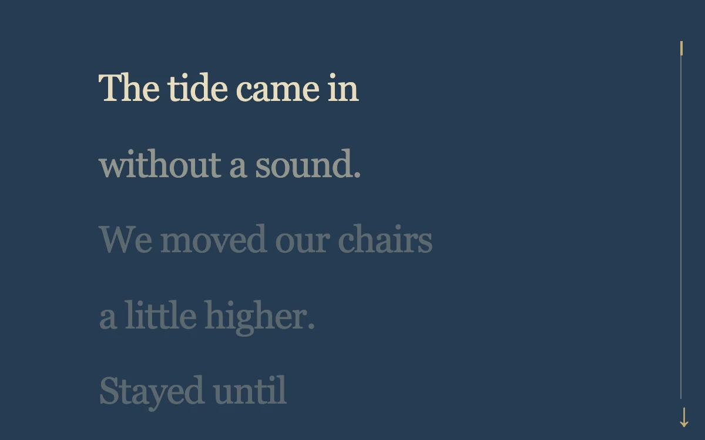

# A little further

> A short poem becomes legible line by line as the reader moves through it.

- **Common name:** Scroll text reveal
- **Category:** Animation & motion
- **Live demo:** https://www.subframe.com/motion/poem-scroll
- **Source:** Subframe (original, MIT)
- **Dependencies:** none

## Use case

Use scroll position as a reading rhythm for concise editorial passages.

## Interaction

Scroll through the poem

## Look

Deep slate-navy page with large cream serif lines fading to muted grey-blue down the column, and a thin gold vertical progress track at right.

## Motion

Scroll progress lights the lines in sequence, raising each from 27% opacity to full as reading reaches it, while a gold bar grows down the right-hand track.

## How to adapt

Each line's opacity is computed inline from `progress` (`1 - (i - progress * 5) * 0.45`, floor `0.27`); the `.track i` bar uses `scaleY`. Replace `lines`, keeping the `5` multiplier equal to the last line index.

## Reduced motion

Live reduced-motion preferences remove interpolation and decorative playback. All content and native controls remain available. Keyboard changes settle immediately.

## Limitations

Original demonstration content; adapt labels and state to the host product.

## Taxonomy

- **Components:** text, progress
- **Triggers:** scroll
- **Techniques:** fade, stagger
- **Feel:** calm, refined
- **Contexts:** editorial
- **Tags:** scroll, text, reading, poem, progress
- **Also known as:** line-by-line fade on scroll, scroll-linked text highlight, reading progress bar, scrollytelling poem
- **Surface color:** `#273c52`

## Code

See [`component.tsx`](component.tsx).
