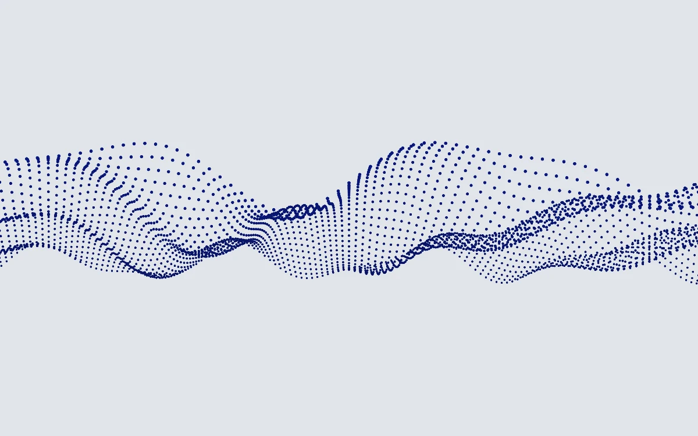

# Point cloud wave

> An ultramarine point sheet rises into a calm three-dimensional swell.

- **Common name:** 3D point cloud wave
- **Category:** WebGL & shaders
- **Live demo:** https://www.subframe.com/motion/point-cloud-wave
- **Source:** Subframe (original, MIT)
- **Dependencies:** none

## Use case

Data, research, and sound identities where a sampled surface communicates structure.

## Interaction

Adjust amplitude

## Look

Rows of small ultramarine dots form a wavy perspective sheet across the middle of a flat pale blue-grey field, leaving wide empty margins.

## Motion

Sine swells travel slowly across 30 rows of perspective-projected points in a continuous rAF loop; the Amplitude slider raises or flattens the swell height live.

## How to adapt

The surface is the `FRAGMENT` shader: the row loop, spacing and `sin` height term shape it, and `u_control` (the Amplitude input via `controlRef`) scales the swell. Swap the dot colour `vec3(.045,.12,.65)` and background `vec3(.88,.90,.92)`; keep the context-loss and reduced-motion handling.

## Reduced motion

A representative frame remains still. Live system preference changes immediately stop the loop; the range control continues to update the still image.

## Limitations

Requires WebGL 1. A static CSS fallback appears when unavailable or after context loss. Procedural projected points without a mesh engine. The wave is illustrative, not live data.

## Taxonomy

- **Components:** background, scene
- **Triggers:** ambient
- **Techniques:** shader, particles, 3d
- **Feel:** calm, technical
- **Contexts:** landing, editorial
- **Tags:** point cloud, particles, wave, surface, projection, native webgl
- **Also known as:** dot wave background, particle wave hero, 3D dot grid wave, wavy dot matrix, data surface animation
- **Surface color:** `#e5e8eb`

## Code

See [`component.tsx`](component.tsx).
