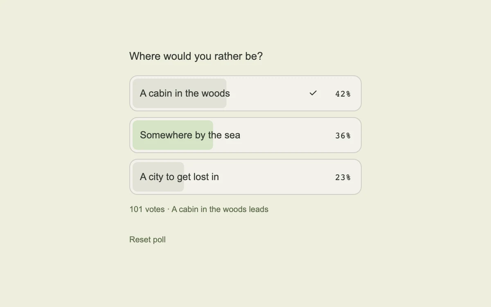

# The results are in

> A choice turns into a small chart, with result fills and percentages moving together.

- **Common name:** Animated poll results
- **Category:** Components & interactions
- **Live demo:** https://www.subframe.com/motion/poll-results
- **Source:** Interior (adapted, MIT) — https://www.interior.dev/docs/poll-results · [original code](https://github.com/ddoemonn/interior/blob/314800833bf01e23e6ae74c2a17fbdaac3688c84/components/interior/poll-results.tsx)
- **Dependencies:** motion@12.0.5

## Use case

Reveal poll results after a vote while keeping the chosen option visible.

## Interaction

Choose a destination

## Look

Pale olive-cream page with a narrow stack of three off-white rounded option rows, grey and sage fill bars, monospace percentages and olive captions.

## Motion

Voting springs each row's clip-path fill to its share while the percentage counts up with it and fades in; once settled, the winner's check pops in with a stiff spring.

## How to adapt

`usePollResults` derives shares, winner and the one-vote guard; each `Row` animates a `motionValue` with the `FILL` spring into a `clipPath` inset and writes the percentage via `useMotionValueEvent`. Replace `OPTIONS` with server results; tune `FILL` and `POP`.

## Reduced motion

Bars and percentages jump to their final values; the winner check appears without scaling.

## Limitations

Votes are local illustrative data. Replace them with server results and preserve the one-vote guard.

## Taxonomy

- **Components:** chart, button
- **Triggers:** press, state
- **Techniques:** spring, mask, fade
- **Feel:** subtle
- **Contexts:** app
- **Tags:** poll, vote, click, data, bar chart, spring, clip-path, percentage, reveal
- **Also known as:** vote results bars, survey results reveal, poll percentage fill, voting widget
- **Surface color:** `#eeeede`

## Code

See [`component.tsx`](component.tsx).
