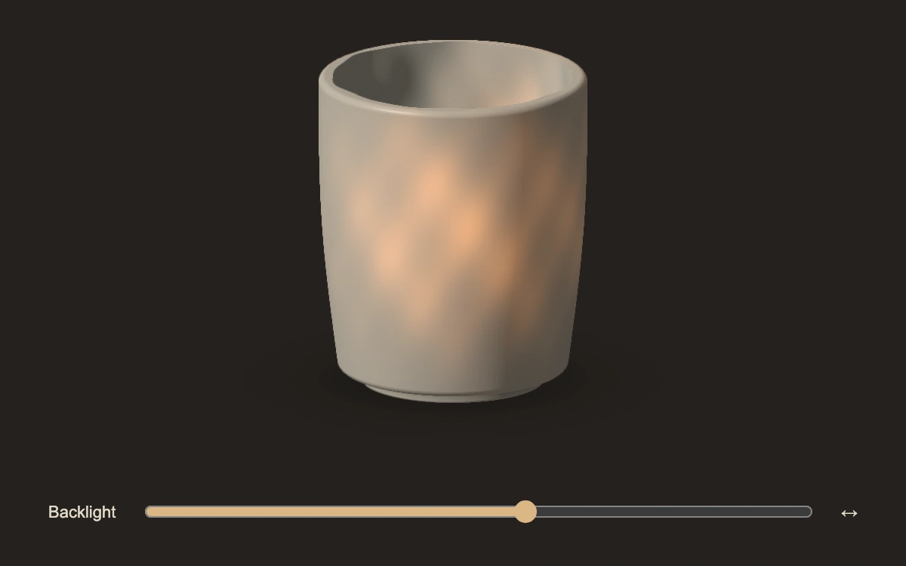

# Porcelain candling

> A warm backlight passes through an ivory vessel's thinner walls while the unlit side stays opaque.

- **Common name:** Thickness-dependent ceramic transmission shader
- **Category:** WebGL & shaders
- **Live demo:** https://www.subframe.com/motion/porcelain-candling
- **Source:** Subframe (original, MIT)
- **Dependencies:** none

## Use case

Reveal material thickness and local variation in a craft or product inspection story.

## Interaction

Drag the backlight across the vessel or use the Backlight slider.

## Look

An ivory open cup on warm black, localized amber transmitted light and an opaque unlit wall; a compact backlight slider below.

## Motion

Pointer or slider input moves a light behind the vessel. The transmission term decreases exponentially with local thickness and absorption while the diffuse exterior remains opaque.

## How to adapt

`DEFAULT_CONFIG` and the `config` prop expose wall thickness, backlight radius and absorption. `thicknessField` defines authored variation, `vessel` defines the shell, and `u_lightX`/`u_lightY` hold the onstage light position.

## Reduced motion

There is no automatic light motion. Direct input updates the stationary backlight without easing.

## Limitations

An authored thickness field and exponential absorption approximation, not a physical subsurface-scattering simulation. No textures or models. Requires WebGL 1 with static original SVG fallback and context restoration.

## Taxonomy

- **Components:** scene, slider
- **Triggers:** drag, keyboard
- **Techniques:** shader, 3d, glow
- **Feel:** refined, technical
- **Contexts:** landing, editorial
- **Tags:** porcelain, transmission, thickness, backlight, material, subsurface, native webgl
- **Also known as:** ceramic translucency, porcelain light, material thickness inspection, candling
- **Surface color:** `#181510`

## Code

See [`component.tsx`](component.tsx).
