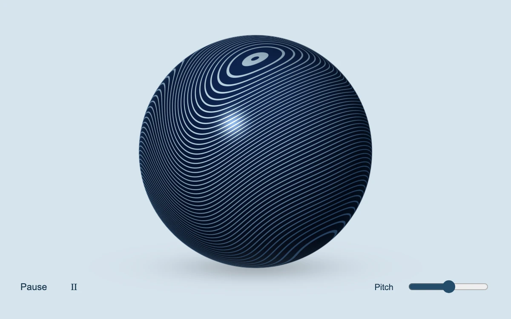

# Engraved orbit

> Fine silver engravings wrap a polished navy sphere, revealing its curvature as the object rotates in a pale studio.

- **Common name:** Engraved 3D sphere shader
- **Category:** WebGL & shaders
- **Live demo:** https://www.subframe.com/motion/poster-sphere
- **Source:** Subframe (original, MIT)
- **Dependencies:** none

## Use case

Procedural material previews, interactive product studies and sculptural identity assets.

## Interaction

Drag or use arrow keys to rotate; adjust engraving pitch and toggle automatic rotation.

## Look

Pale powder-blue studio with a glossy navy sphere wrapped in fine pale-silver contour lines, a soft floor shadow, and minimal navy controls.

## Motion

The engraved sphere spins continuously about its vertical axis at 0.15 rad/s; dragging or arrow keys stop the spin and turn or tilt it directly, and pitch changes line density.

## How to adapt

Everything renders in the `FRAGMENT` shader: spin speed is `u_time*.15`, line count `(14.+u_ink*25.)`, and drag feeds `u_pointer` from `pointer`. Recolour `enamel` and `metal` for your material; keep `cancelDrag`, context-loss and reduced-motion handling.

## Reduced motion

Automatic rotation stops; manual rotation and pitch changes redraw immediately. Host pause stops the clock and cancels an unfinished drag.

## Limitations

An analytic shader sphere with procedural engraved latitude lines and approximate studio lighting; no mesh model, environment map or exported 3D asset. Requires WebGL 1.

## Taxonomy

- **Components:** scene
- **Triggers:** ambient, drag, keyboard
- **Techniques:** shader, 3d, rotate
- **Feel:** refined, calm
- **Contexts:** landing, editorial
- **Tags:** webgl, glsl, sphere, engraving, material, reflection, drag, procedural
- **Also known as:** draggable 3D sphere, WebGL sphere, rotating striped ball, procedural material sphere
- **Surface color:** `#d6e3ed`

## Code

See [`component.tsx`](component.tsx).
