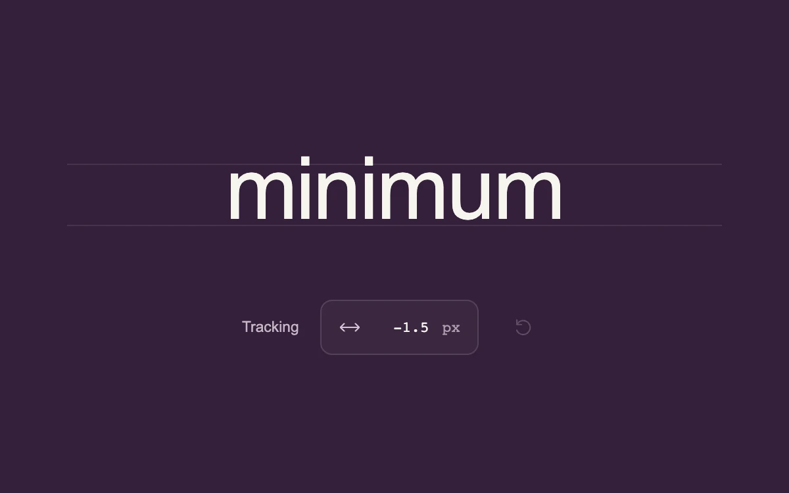

# Precision scrub

> A compact numerical field sets the spacing of a white typographic specimen on a deep plum proofing surface.

- **Common name:** Scrubbable number input
- **Category:** Components & interactions
- **Live demo:** https://www.subframe.com/motion/precision-scrub
- **Source:** Subframe (original, MIT)
- **Dependencies:** none

## Use case

Space-efficient numerical editing with direct scrubbing, precise entry, and reversible gestures.

## Interaction

Drag the value, click to type, or use arrow keys; Shift accelerates and Alt refines

## Look

Deep plum surface with a large off-white sans-serif specimen word between faint guide lines, above a small outlined monospace value chip and reset icon.

## Motion

Dragging the chip scrubs letter-spacing live at 0.1 px per pixel (Shift faster, Alt finer); overshooting the -3 to 12 range nudges the chip, which eases back in 180 ms.

## How to adapt

Scrub math is in the chip's `onPointerMove` (multipliers `0.025`, `0.5`, `0.1`; 4 px dead zone) feeding `change`; the -3 to 12 bounds repeat in `clamp`, the drag and arrow keys. Replace `tracking` and the `letterSpacing` specimen with your own value.

## Reduced motion

Values and typesetting update directly; the small boundary response settles immediately.

## Limitations

A local letter-spacing control bounded from -3 to 12 pixels; no pointer lock or document editor integration.

## Taxonomy

- **Components:** slider, input
- **Triggers:** drag, keyboard, press
- **Techniques:** slide
- **Feel:** technical, subtle
- **Contexts:** app
- **Tags:** scrub, input, number, typography, tracking, precision, drag
- **Also known as:** drag to adjust value, number scrubber, draggable number field, letter-spacing control
- **Surface color:** `#341f39`

## Code

See [`component.tsx`](component.tsx).
