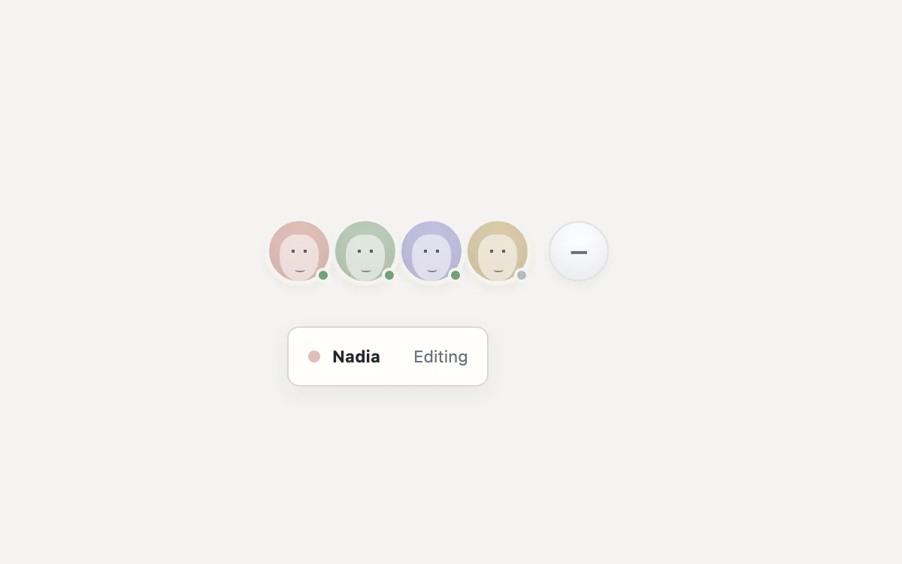

# Presence pile

> Reveal who is present while keeping collaboration chrome compact.

- **Common name:** Avatar stack
- **Category:** Components & interactions
- **Live demo:** https://www.subframe.com/motion/presence-pile
- **Source:** Subframe (original, MIT)
- **Dependencies:** none

## Use case

Reveal who is present while keeping collaboration chrome compact.

## Interaction

Inspect or add a collaborator

## Look

Warm off-white page with four pastel circular avatars bearing minimal faces and status dots, a pale round toggle, and a small white name card.

## Motion

Selecting an avatar or the plus button fans the overlapping avatars apart with a 240 ms ease-out translate, and a name-and-status card fades in while settling 5 px downward.

## How to adapt

The fan-out is the inline `translateX` on each `people` button (`i * 10` px; 40 px for `more`) eased by a 240 ms transition; the card toggles via `data-open`. Replace the `people` array (`name`, `role`, `color`) with live presence data.

## Reduced motion

Live system preference disables decorative motion; all controls remain usable. Keyboard actions settle immediately.

## Limitations

Illustrative local collaborators. Avatar artwork is CSS generated; no external images or live presence service.

## Taxonomy

- **Components:** disclosure, tooltip
- **Triggers:** press
- **Techniques:** slide, fade
- **Feel:** subtle
- **Contexts:** app
- **Tags:** presence, avatar, collaboration, expand
- **Also known as:** avatar group, facepile, collaborator avatars, who's online indicator, expanding avatar group
- **Surface color:** `#edf0f3`

## Code

See [`component.tsx`](component.tsx).
