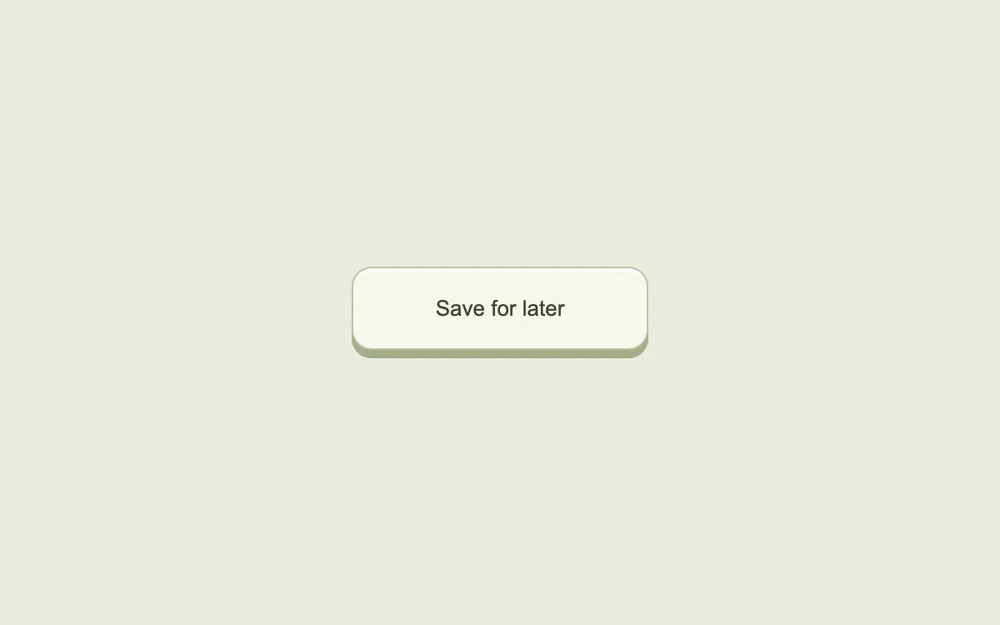

# A button with depth

> A raised button presses down from the point you touch, then returns with a spring.

- **Common name:** 3D press button
- **Category:** Components & interactions
- **Live demo:** https://www.subframe.com/motion/press-depth
- **Source:** Interior (adapted, MIT) — https://www.interior.dev/docs/press-depth · [original code](https://github.com/ddoemonn/interior/blob/314800833bf01e23e6ae74c2a17fbdaac3688c84/components/interior/press-depth.tsx)
- **Dependencies:** motion@12.0.5

## Use case

Give an occasional action a tactile response without moving its hit area.

## Interaction

Press near different edges of the button

## Look

Pale sage page with one wide off-white rounded button raised on a darker olive base, with a dark grey sans-serif label.

## Motion

Pressing sinks the button face 5 px and tilts it up to 7° toward the touch point with a stiff spring, tinting it pale green; release springs it back.

## How to adapt

`usePressDepth` tracks press state and the normalised `origin`; the face is a `motion.span` animating `y`, `rotateX`, `rotateY` and `backgroundColor` with the `PRESS` spring (`stiffness: 520`, `damping: 34`). Replace the label and `saved` toggle; tune the 7° tilt and 5 px travel.

## Reduced motion

The button stays stationary and uses color to show its pressed state.

## Limitations

The example toggles a local saved state. Avoid adding this motion to high-frequency controls.

## Taxonomy

- **Components:** button
- **Triggers:** press, keyboard
- **Techniques:** spring, 3d
- **Feel:** playful, refined
- **Contexts:** app, landing
- **Tags:** button, press, pointer, tilt, 3D, spring, depth, keyboard
- **Also known as:** tactile push button, raised keycap button, tilt on press button, skeuomorphic button
- **Surface color:** `#e9eadf`

## Code

See [`component.tsx`](component.tsx).
