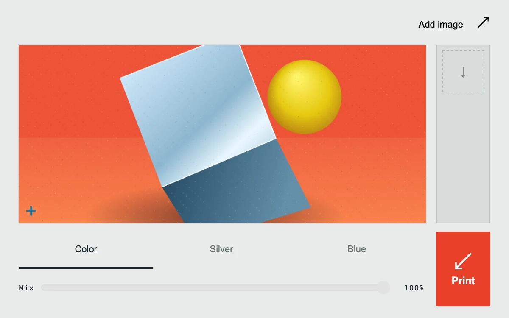

# Print lab

> A working image proofing bench develops color treatments into a downloadable contact strip.

- **Common name:** Image filter editor
- **Category:** Components & interactions
- **Live demo:** https://www.subframe.com/motion/print-lab
- **Source:** Subframe (original, MIT)
- **Dependencies:** none

## Use case

Preview image treatments and keep comparable snapshots without switching between tools.

## Interaction

Choose a treatment, adjust its mix, and print a proof

## Look

Grey workbench with a red-orange still life of folded pale-blue metal and a yellow sphere, a narrow proof strip, underlined tabs and red button.

## Motion

Treatment and mix changes re-render the canvas instantly; printing captures a PNG proof whose thumbnail drops into the strip from −12 px and −3°, fading in over 0.32 s.

## How to adapt

Filtering is a per-pixel luminance duotone in the `stock`/`strength` effect, mixing `ink` and `paper` colours; `print` stores up to four `toDataURL` proofs animated by the `sf-proof-delivery` keyframes. Replace `drawStillLife` with your default image and edit `stocks` and their ink pairs.

## Reduced motion

Proofs appear immediately; processing, capture, and downloads still work.

## Limitations

Includes original procedural artwork and optional local image input. Four in-memory PNG proofs, no camera or storage. Images crop to560×400. Canvas2D processing, not AI filtering.

## Taxonomy

- **Components:** editor, image
- **Triggers:** press, state
- **Techniques:** canvas, fade, slide
- **Feel:** technical
- **Contexts:** app
- **Tags:** image, filter, capture, canvas, Canvas2D, duotone, proof, compositing, snapshot
- **Also known as:** duotone photo filter, photo proof strip, image treatment preview, canvas photo filter
- **Surface color:** `#e9ebea`

## Code

See [`component.tsx`](component.tsx).
