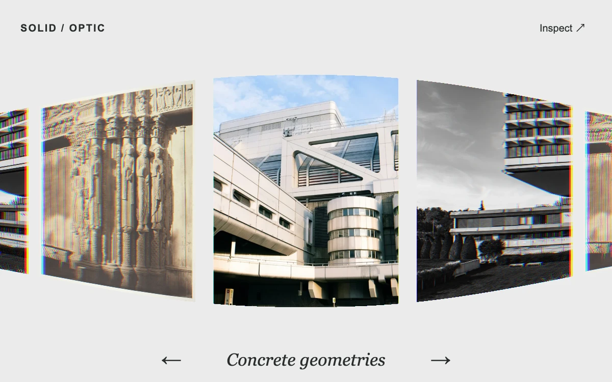

# Prism carousel

> An architectural photo strip bends through a clear optical edge, then expands a selected image into an undistorted inspection view.

- **Common name:** Refraction image carousel
- **Category:** WebGL & shaders
- **Live demo:** https://www.subframe.com/motion/prism-carousel
- **Source:** Subframe (original, MIT)
- **Dependencies:** none

## Use case

Give a compact visual collection a material transition while preserving a clear enlarged image.

## Interaction

Drag or step through images, then choose Inspect.

## Look

Light gray stage with a strip of architectural photos bent and stretched toward the edges with RGB fringing, an italic serif caption and arrow buttons.

## Motion

Dragging or stepping slides the strip through a refracting edge lens, snapping to the nearest print on a damped spring; Inspect relaxes the lens and crossfades to the enlarged print.

## How to adapt

Motion runs in `tick`: a spring (155 stiffness, `Math.exp(-22 * dt)` damping) moves `position` toward `target`, and `focus` eases with a 0.11 s constant; the `prism` shader's `rim` term sets lens strength. Replace `prints`; the atlas assumes three images.

## Reduced motion

Stepping and inspection settle immediately; the stationary optical treatment remains.

## Limitations

Native WebGL 1 and three local images. The lens is an artistic UV refraction, not a physically traced glass object; a flat image is the fallback.

## Taxonomy

- **Components:** gallery, image
- **Triggers:** drag, press
- **Techniques:** shader, distortion, spring
- **Feel:** bold, refined
- **Contexts:** editorial, landing
- **Tags:** carousel, refraction, chromatic dispersion, WebGL, drag, focus
- **Also known as:** curved image slider, lens distortion carousel, chromatic aberration slider, cylindrical photo carousel, draggable image strip
- **Surface color:** `#eaebea`

## Assets

- [`cathedral-columns.webp`](../../assets/cathedral-columns.webp) — Chartres Cathedral, West Facade; Royal Portal, Central Bay (CC0-1.0)
- [`concrete-geometries.webp`](../../assets/concrete-geometries.webp) — Modern brutalist architecture with geometric shapes (Unsplash)
- [`concrete-projections.webp`](../../assets/concrete-projections.webp) — Brutalist concrete office building (Unsplash)

## Code

See [`component.tsx`](component.tsx).
