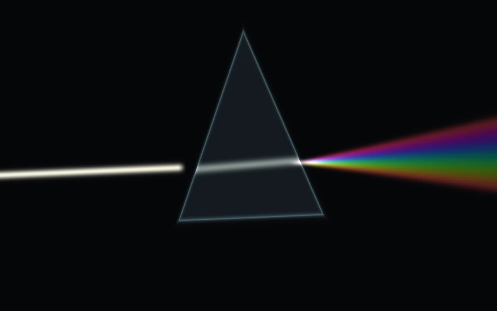

# Prismatic dispersion

> A narrow white beam opens into a spectral fan through a glass wedge.

- **Common name:** Prism light shader
- **Category:** WebGL & shaders
- **Live demo:** https://www.subframe.com/motion/prismatic-dispersion
- **Source:** Subframe (original, MIT)
- **Dependencies:** none

## Use case

Communicate optics, decomposition, or a focused reveal without a full 3D engine.

## Interaction

Adjust spread

## Look

Black field with a translucent outlined glass triangle; a cream beam enters from the left and leaves as a soft rainbow fan to the right.

## Motion

The prism, beam and spectral fan rock together up to 2.6° each way on a slow 26-second sine; the spread slider widens or narrows the nine-ray rainbow fan live.

## How to adapt

Everything is drawn in `main` of `FRAGMENT`: `wedge` is the prism, `beam` the incoming light and a nine-step loop builds the fan from `hue` rays scaled by `spread`. Tune `spread` and the `rotate` sway; `controlRef` feeds `u_control`; keep the reduced-motion still frame.

## Reduced motion

A representative frame remains still. Live system preference changes immediately stop the loop; the range control continues to update the still image.

## Limitations

Requires WebGL 1. A static CSS fallback appears when unavailable or after context loss. An explanatory 2D optics composition, not raytraced physical dispersion.

## Taxonomy

- **Components:** background, scene
- **Triggers:** ambient, state
- **Techniques:** shader, glow, rotate
- **Feel:** bold, calm
- **Contexts:** landing, editorial
- **Tags:** prism, dispersion, spectrum, light, refraction, native webgl
- **Also known as:** prism rainbow, light refraction effect, spectrum beam, rainbow dispersion background
- **Surface color:** `#111518`

## Code

See [`component.tsx`](component.tsx).
