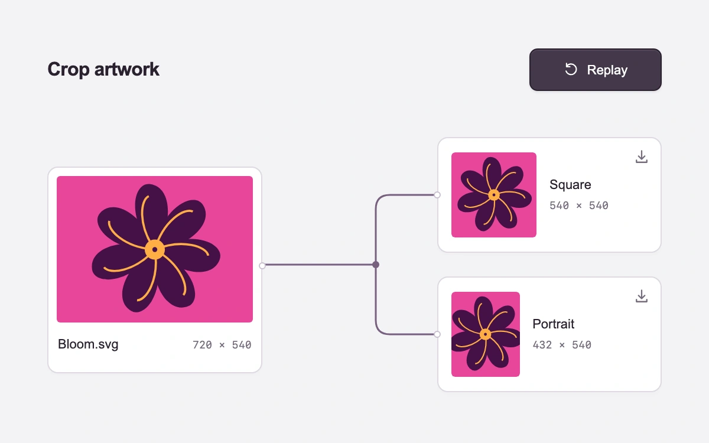

# Asset crop workflow

> One original artwork branches into square and portrait crops, with each connection leading to a downloadable result.

- **Common name:** Animated workflow diagram
- **Category:** Animation & motion
- **Live demo:** https://www.subframe.com/motion/process-choreography
- **Source:** Subframe (original, MIT)
- **Dependencies:** none

## Use case

Explain an asset transformation through directed connections and concrete outputs that retain the source image's identity.

## Interaction

Create crops, cancel or replay, then download either SVG

## Look

Light lilac-grey workspace with white rounded cards: a magenta-and-plum flower artwork on the left joined by thin purple elbow connectors to square and portrait crops.

## Motion

A button starts a 1.12 s sequence: connector strokes draw toward each output, dashed crop guides appear on the artwork, then each crop fades up and scales in (cubic ease-out).

## How to adapt

One rAF clock advances `progress` over `DURATION` (1120 ms); `segment` maps it to the `trunk` and `branch` stroke offsets and to each crop's `start`/`end` window, eased by `easeOut`. Replace `Artwork` and the `crops` viewBoxes with your asset and outputs.

## Reduced motion

Both crops appear immediately. The native action and SVG downloads stay available.

## Limitations

Two centered viewBox crops of an original SVG artwork. The short reveal sequence explains their relationship; it does not represent network or rendering progress. No image upload, raster conversion or external service.

## Taxonomy

- **Components:** chart, card
- **Triggers:** press
- **Techniques:** path, stagger, fade, scale
- **Feel:** subtle, technical
- **Contexts:** app, landing
- **Tags:** workflow, diagram, branching, sequence, crop, asset, SVG, export, download
- **Also known as:** node workflow animation, pipeline diagram, branching flow diagram, connector line draw, export flow illustration
- **Surface color:** `#f4f3f6`

## Code

See [`component.tsx`](component.tsx).
