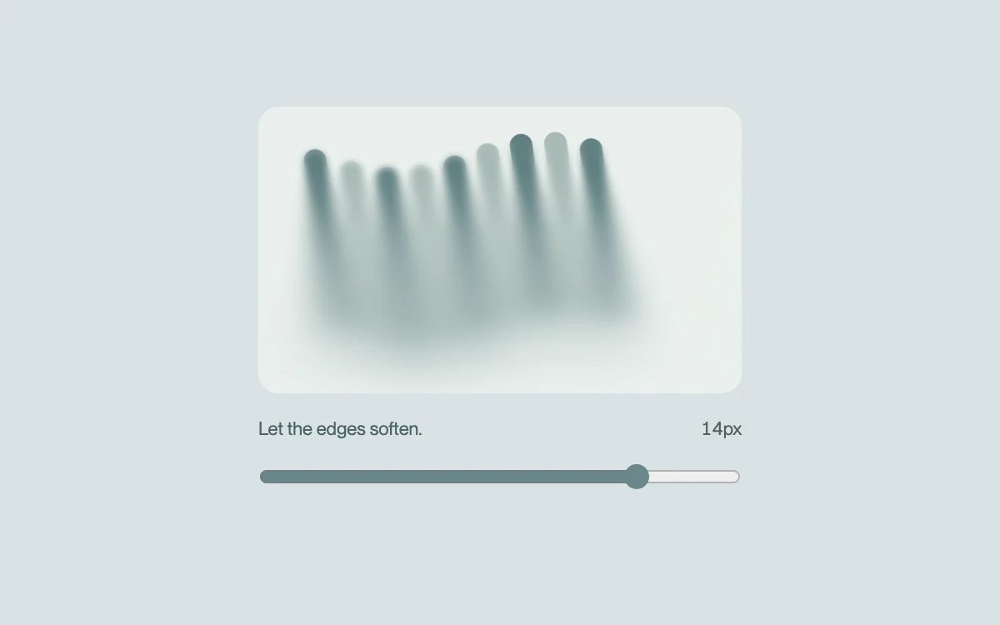

# A softer edge

> Layered masks turn a sharp surface into a gradual, adjustable blur.

- **Common name:** Progressive blur
- **Category:** Animation & motion
- **Live demo:** https://www.subframe.com/motion/progressive-blur
- **Source:** Motion Primitives (adapted, MIT) — https://motion-primitives.com/docs/progressive-blur · [original code](https://github.com/ibelick/motion-primitives/blob/120f64f6ca60348e251f929e9c81f11ccbe45eda/components/core/progressive-blur.tsx)
- **Dependencies:** none

## Use case

Soften the edge of decorative media or create a gradual transition behind a floating surface.

## Interaction

Adjust the blur intensity

## Look

Pale blue-grey page with a rounded pale-mint card of tilted teal and sage bars blurring toward the bottom, above a caption and range slider.

## Motion

The range slider scales the radius of eight masked backdrop-blur bands that deepen toward the bottom, while the striped artwork bobs and tilts on a 10 s ease-in-out loop.

## How to adapt

The blur is eight `backdropFilter` layers whose overlapping `maskImage` gradients step the radius by index; tune `layers`, `segmentSize`, `intensity` and the `180deg` direction. The SVG bars and `sf-progressive-blur-drift` keyframes are demo artwork; place real media underneath.

## Reduced motion

The artwork stays still. The blur control remains usable and updates immediately.

## Limitations

Eight backdrop-filter layers can be expensive on large surfaces. Keep the region small; browsers without backdrop-filter show sharp artwork.

## Taxonomy

- **Components:** image
- **Triggers:** state, ambient
- **Techniques:** blur, mask
- **Feel:** refined, subtle
- **Contexts:** app, landing
- **Tags:** blur, progressive, backdrop-filter, gradient mask, range, CSS, soft focus
- **Also known as:** gradient blur, variable blur edge, blur fade mask, backdrop blur gradient, soft focus edge
- **Surface color:** `#d9e2e3`

## Code

See [`component.tsx`](component.tsx).
