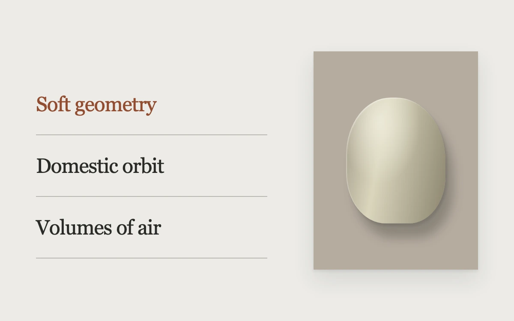

# Objects in practice

> A quiet project list selects dimensional still lifes beside a separate image window.

- **Common name:** Hover image preview list
- **Category:** Animation & motion
- **Live demo:** https://www.subframe.com/motion/project-index
- **Source:** Subframe (original, MIT)
- **Dependencies:** none

## Use case

Let a small studio index remain scannable while showing a rich preview for the focused project.

## Interaction

Hover, focus or choose a project.

## Look

Warm off-white page with a hairline-divided serif project list beside a shadowed taupe panel showing a soft sculpted object; the active title is rust.

## Motion

Hovering, focusing or clicking a title slides a vertical reel of stills inside the fixed preview window to that project in 240 ms with ease-out; keyboard input switches instantly.

## How to adapt

The window holds a `.reel` translated by `selected` (`translateY`), with the `.24s cubic-bezier(.2,.85,.25,1)` transition in the inline style. Replace `names` and the CSS-drawn `.still` shapes with real project titles and images.

## Reduced motion

Preview changes and keyboard navigation settle immediately under reduced motion; host pause disables selections.

## Limitations

Three original CSS still lifes with no navigation or external images. Adapt the selected project state to actual product content.

## Taxonomy

- **Components:** list, image
- **Triggers:** hover, keyboard, press
- **Techniques:** slide
- **Feel:** refined, subtle
- **Contexts:** editorial, landing
- **Tags:** portfolio, hover, index, image reveal, keyboard, preview, selection
- **Also known as:** portfolio project list, image reveal on hover, work index with preview, hover to preview project
- **Surface color:** `#ecebe 7`

## Code

See [`component.tsx`](component.tsx).
