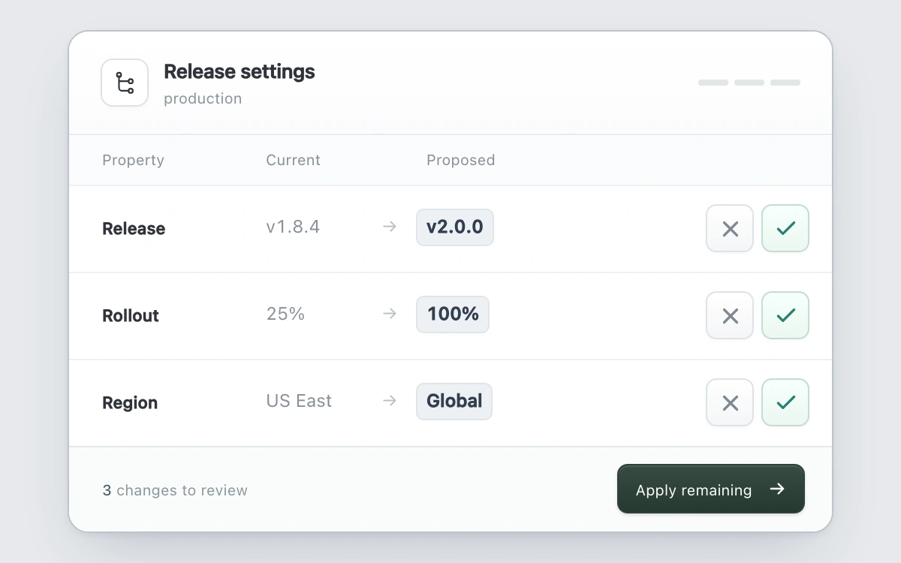

# Proposal ledger

> Proposed settings move into the current column when accepted, with explicit applied and kept states.

- **Common name:** Change approval table
- **Category:** Components & interactions
- **Live demo:** https://www.subframe.com/motion/proposal-ledger
- **Source:** Subframe (original, MIT)
- **Dependencies:** none

## Use case

Review an agent's field edits individually and apply only undecided changes.

## Interaction

Accept or reject each field, undo a decision, or apply the remaining changes.

## Look

Cool grey page with a white rounded three-row table: muted values, arrows to chip-styled proposals, cross and green check buttons, dark green footer button.

## Motion

Accepting a row slides its proposed chip left into the current column (260 ms ease-out) while the old value fades and the row tints green; rejecting fades the proposal right.

## How to adapt

All motion is CSS keyed on each `change` row's `data-state`: `.new` shifts `translateX(-107px)` on accept while `.old` and `.direction` fade, over 260 ms `cubic-bezier(.22,1,.36,1)`. Replace `CHANGES` with real proposed edits and persist `decisions` set by `decide`.

## Reduced motion

Finite transitions become immediate under reduced motion and keyboard input. Host pause disables controls; any owned drag is cancelled.

## Limitations

Three local release settings; acceptance only updates this example's in-memory state. Wire confirmed decisions to application data in an integration.

## Taxonomy

- **Components:** table
- **Triggers:** press, state
- **Techniques:** slide, fade
- **Feel:** subtle, technical
- **Contexts:** app, dashboard
- **Tags:** approval, diff, agent-ui, review, table, accept-reject, undo, value-transition
- **Also known as:** accept reject changes, AI suggestion review, diff review table, approve proposed edits, change review panel
- **Surface color:** `#e6e9ed`

## Code

See [`component.tsx`](component.tsx).
