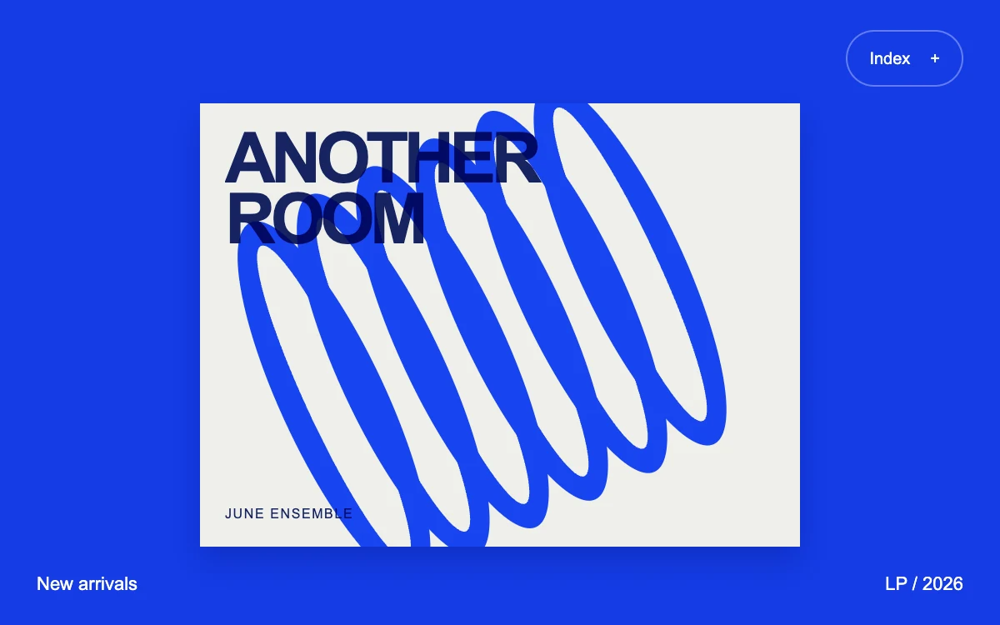

# Push navigation

> A cobalt record sleeve moves aside to expose a quiet collection index behind it.

- **Common name:** Push menu drawer
- **Category:** Components & interactions
- **Live demo:** https://www.subframe.com/motion/push-navigation
- **Source:** Subframe (original, MIT)
- **Dependencies:** none

## Use case

Reveal navigation while preserving the spatial identity of the current content.

## Interaction

Open the index and choose a collection.

## Look

Saturated cobalt-blue full-bleed plate holding an off-white record sleeve with heavy navy sans-serif title and blue looping ring artwork, plus an outlined pill button.

## Motion

The toggle slides the blue plate 54% right, scales it to 88% and rounds its corners over 380 ms ease-out, exposing the list behind; choosing an item slides it back.

## How to adapt

The push is one transform on `.pn-plate`: `translateX(54%) scale(.88)` under `[data-open=true]` with a `.38s cubic-bezier(.22,1,.36,1)` transition; `.pn-drawer` sits beneath, `inert` while closed. Replace `collections`, the sleeve art and titles with your routes.

## Reduced motion

The foreground plate changes position immediately, retaining all navigation.

## Limitations

An isolated collection selector, not a router or full-page template. The background navigation is inert while closed.

## Taxonomy

- **Components:** navigation, sheet, menu
- **Triggers:** press, keyboard
- **Techniques:** slide, scale
- **Feel:** refined, bold
- **Contexts:** editorial, app
- **Tags:** navigation, drawer, push, disclosure, CSS transform
- **Also known as:** off-canvas menu, slide-out navigation, push sidebar, hamburger menu reveal
- **Surface color:** `#153ce6`

## Code

See [`component.tsx`](component.tsx).
