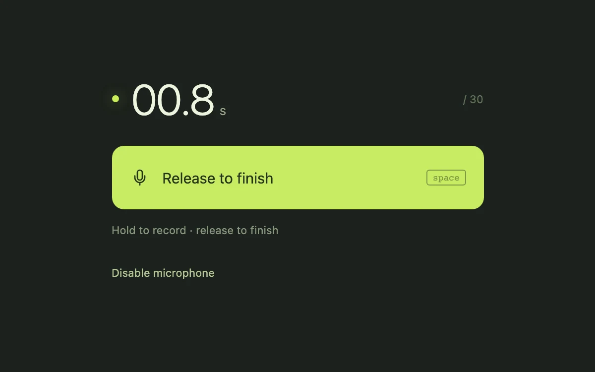

# Push to talk

> A momentary recording control captures a local voice note and hands off to playback on release.

- **Common name:** Hold-to-record voice button
- **Category:** Components & interactions
- **Live demo:** https://www.subframe.com/motion/push-to-talk
- **Source:** Subframe (original, MIT)
- **Dependencies:** none

## Use case

Leave a short voice message without a persistent recording mode.

## Interaction

Enable the microphone, hold to record, release to finish, then play the take.

## Look

Near-black green-tinted page with a large thin-weight seconds counter, a glowing lime dot and a wide lime rounded button with a microphone icon.

## Motion

Holding the button records: it turns dark olive to lime in 140 ms, a dot glows and a counter ticks toward 30 s; releasing saves a playable take.

## How to adapt

Recording runs through `start` and `stop` in the `hold` button's pointer and key handlers using `MediaRecorder`; visuals are `.hold[data-recording=true]` (140 ms transition) and the `light` dot. Tune the 30 s cap in the `setInterval` effect; upload the `Blob` built in `onstop`.

## Reduced motion

Recording feedback changes state without color tweening. Actual capture and playback remain opt-in.

## Limitations

Requires microphone permission and MediaRecorder support. Takes are capped at 30 seconds, stored only in memory and discarded on unmount.

## Taxonomy

- **Components:** button, media
- **Triggers:** press, keyboard
- **Techniques:** gradient, glow
- **Feel:** subtle
- **Contexts:** app
- **Tags:** voice, recording, microphone, hold, media-recorder, audio
- **Also known as:** voice memo recorder, walkie-talkie button, press and hold microphone, voice note capture, audio message button
- **Surface color:** `#1c211c`

## Code

See [`component.tsx`](component.tsx).
