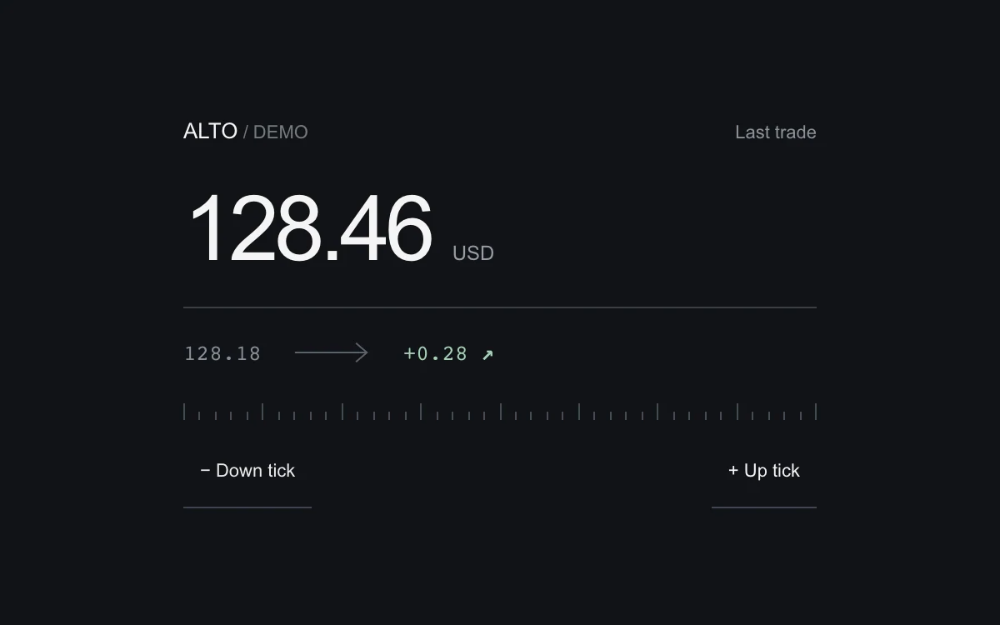

# Quote tick

> A changing quote retains its previous value and emphasizes the direction of each update.

- **Common name:** Stock price ticker
- **Category:** Components & interactions
- **Live demo:** https://www.subframe.com/motion/quote-tick
- **Source:** Subframe (original, MIT)
- **Dependencies:** none

## Use case

Make metric changes legible without asking a user to remember the last number.

## Interaction

Apply an up or down tick and compare the previous value and signed difference.

## Look

Near-black panel with a large white tabular price, a monospace row comparing previous value and green delta, a tick-mark ruler and underlined text buttons.

## Motion

Each update remounts the price, which fades in while sliding 8 px up (gain) or down (loss) over 220 ms ease-out, tinted green or red for 800 ms.

## How to adapt

The entrance is the `quote-w2` keyframes on `.number`, restarted by `key={quote.id}` with direction from `--tick-travel`; the colour flash is `data-flash`, cleared by an 800 ms `setTimeout`. Call `update` with deltas from your feed instead of the fixed `-0.37` and `0.52` buttons.

## Reduced motion

Numbers and signed differences update immediately without vertical motion or fading.

## Limitations

Manually generated example values, not market data or an investment interface.

## Taxonomy

- **Components:** number
- **Triggers:** state, press
- **Techniques:** slide, fade
- **Feel:** subtle, technical
- **Contexts:** dashboard, app
- **Tags:** metric, delta, comparison, value-flash, direction, finance, number, update
- **Also known as:** price change flash, live quote update, value delta indicator, metric change highlight
- **Surface color:** `#111316`

## Code

See [`component.tsx`](component.tsx).
