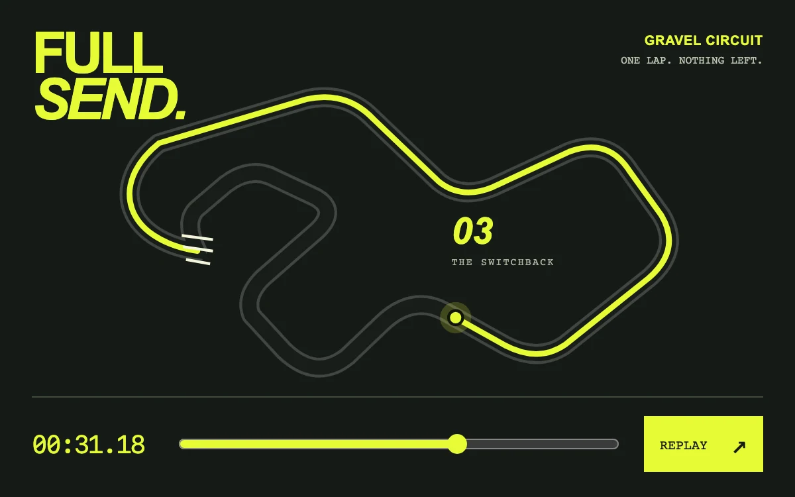

# Full send

> An acid-yellow racing line draws a complete lap, with a marker and elapsed time bound to one timeline.

- **Common name:** Animated route path
- **Category:** Animation & motion
- **Live demo:** https://www.subframe.com/motion/race-replay
- **Source:** Subframe (original, MIT)
- **Dependencies:** none

## Use case

Explain a route, replay a sporting moment or connect progress along a path with a time-based story.

## Interaction

Replay or scrub the lap

## Look

Near-black layout with heavy italic acid-yellow headline, a grey circuit outline traced in neon yellow with a ringed marker, monospace timer, slider and yellow button.

## Motion

Replay draws the yellow line around the circuit linearly over 4.6 s, a marker riding its tip and the timer counting up; the range slider scrubs the same progress.

## How to adapt

`paint` maps one 0–1 `fraction` to `strokeDashoffset` on the `pathLength="1"` line, the marker via `getPointAtLength` and the timer; `tick` advances it over `4600` ms. Replace `circuit` with your route path and the `48.72` lap time and labels.

## Reduced motion

Automatic playback stops. The range remains directly controllable, and replay shows the completed lap immediately. Keyboard replay is also immediate.

## Limitations

This is a fictional circuit with constant path progress, not measured telemetry. A 48.72-second illustrative lap is compressed to 4.6 seconds for preview.

## Taxonomy

- **Components:** chart, progress, media
- **Triggers:** press, drag
- **Techniques:** path
- **Feel:** bold, technical
- **Contexts:** editorial, landing
- **Tags:** racing, path, route, SVG, draw, timeline, scrub, replay, sports, progress
- **Also known as:** route drawing animation, race track replay, SVG line draw, path progress scrubber, map route animation
- **Surface color:** `#161b16`

## Code

See [`component.tsx`](component.tsx).
