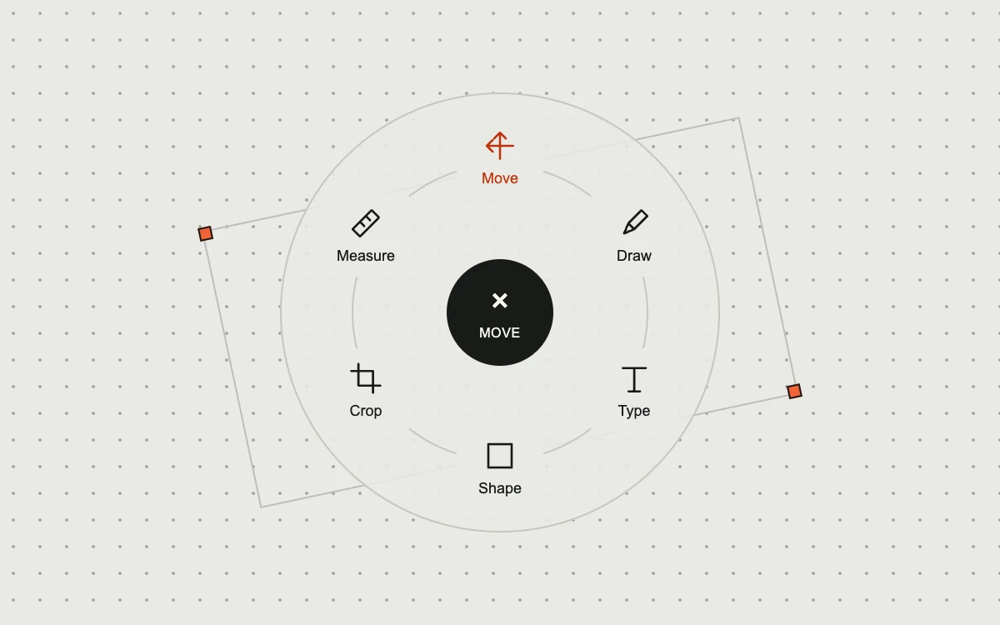

# Within reach

> Six drawing tools unfold around a fixed point on a spare drafting surface.

- **Common name:** Radial menu
- **Category:** Components & interactions
- **Live demo:** https://www.subframe.com/motion/radial-tool-menu
- **Source:** Subframe (original, MIT)
- **Dependencies:** none

## Use case

Offer a small, spatially stable set of tools close to the area of work in a drawing or annotation interface.

## Interaction

Choose a tool, reopen the dial, or use arrow keys and Escape

## Look

Pale grey dot-grid drafting surface with a circular dial of six line icons around a black centre button, plus orange-red accents and a tilted frame.

## Motion

Pressing the centre button fans six tools outward from a 40 px to 93 px radius over 200 ms (expo-out) as they fade in; closing hides them at once.

## How to adapt

Positions come from `angle` (60° steps) in `tools.map`, with the radius switching between 93 and 40 on `open`; easing is the `sf-radial-tool` transition. Replace `tools` and `glyphs`, and connect `setSelected` to your tool state.

## Reduced motion

Tools appear and disappear in their final positions. Keyboard opening, navigation and selection are immediate.

## Limitations

Demonstrates local tool selection. It does not implement a drawing engine, viewport-edge repositioning, nested menus or a drag-to-select marking gesture.

## Taxonomy

- **Components:** menu
- **Triggers:** press
- **Techniques:** slide, fade
- **Feel:** technical, refined
- **Contexts:** app
- **Tags:** radial, menu, toolbar, drawing, canvas, selection, polar, keyboard, industrial, monochrome, orange
- **Also known as:** pie menu, circular tool picker, marking menu, tool wheel, circular action menu
- **Surface color:** `#e9e9e5`

## Code

See [`component.tsx`](component.tsx).
