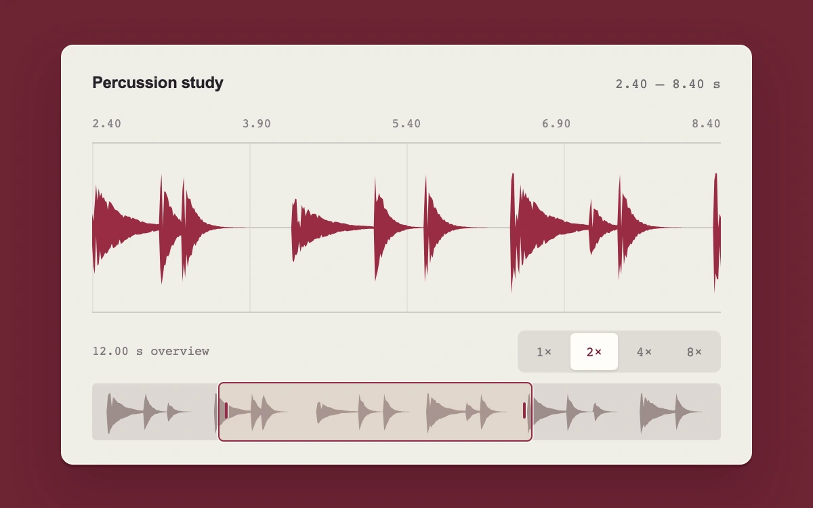

# Percussion navigator

> A detailed percussion waveform stays connected to a draggable overview as you pan and magnify its transients.

- **Common name:** Waveform zoom navigator
- **Category:** Components & interactions
- **Live demo:** https://www.subframe.com/motion/range-zoom
- **Source:** Subframe (original, MIT)
- **Dependencies:** none

## Use case

Navigating audio, sensor signals, or other dense time series while keeping the full sequence in view.

## Interaction

Drag the overview window or choose 1×, 2×, 4×, or 8× magnification

## Look

Deep burgundy backdrop with a cream panel showing a crimson filled waveform on faint gridlines, monospace time labels, a segmented zoom control and a minimap.

## Motion

Dragging the minimap window with the pointer pans the detailed waveform, and the 1×–8× buttons rezoom around the current centre; both redraw the min/max envelope instantly, untweened.

## How to adapt

`view` (start, span) feeds the detail `signalPath` and window position, `zoom` keeps the centre fixed, and pointer handlers shift `start` within `DURATION`. Replace `samples` (and the precomputed `overview`) with decoded audio or sensor data.

## Reduced motion

All waveform navigation is immediate; reduced motion also removes control color transitions.

## Limitations

One deterministic 12-second synthetic percussion signal; no audio playback, media import, trimming, or real-time recording. Min/max envelopes sample the same data at both scales.

## Taxonomy

- **Components:** media, editor, chart
- **Triggers:** drag, press, keyboard
- **Techniques:** slide, scale
- **Feel:** technical
- **Contexts:** app, dashboard
- **Tags:** waveform, audio, signal, timeline, zoom, overview, navigator, pan, range, editor
- **Also known as:** timeline minimap, waveform overview scrollbar, audio zoom and pan, brush zoom chart, range navigator
- **Surface color:** `#6d2434`

## Code

See [`component.tsx`](component.tsx).
