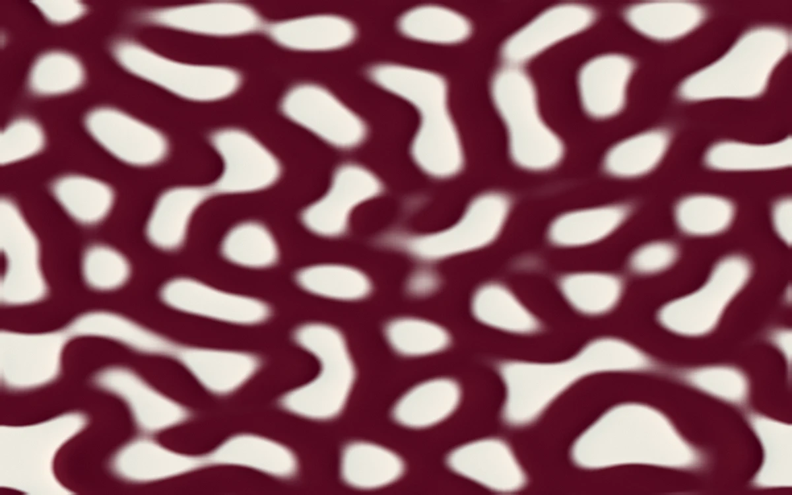

# Reaction lab

> Oxblood colonies divide into a living two-chemical pattern on a pale field.

- **Common name:** Reaction-diffusion shader
- **Category:** WebGL & shaders
- **Live demo:** https://www.subframe.com/motion/reaction-lab
- **Source:** Subframe (original, MIT)
- **Dependencies:** none

## Use case

Shape a persistent reaction-diffusion material through its growth parameter.

## Interaction

Adjust growth.

## Look

Full-bleed two-tone pattern of deep oxblood ink and pale cream paper: rounded, soft-edged spots and branching worm shapes like Turing or coral markings.

## Motion

The Gray-Scott simulation steps about 180 times per second, so oxblood colonies slowly grow, split and merge; dragging the growth slider raises feed and kill rates and advances 30 steps.

## How to adapt

`evolve` runs the Gray-Scott solver on a 128×128 grid (feed and kill derive from `controlRef`), `advance` paces it at 180 steps per second, and `FRAGMENT` maps chemical B to the `paper` and `pigment` colours. Retune those; keep the context-loss fallback.

## Reduced motion

The simulation clock stops. Adjusting growth advances a finite preview; it then remains still.

## Limitations

Requires WebGL 1; a static CSS swatch appears if unavailable or after context loss. A 128×128 CPU Gray–Scott grid uploaded to WebGL; the control advances a finite preview while paused. Not a GPU compute solver.

## Taxonomy

- **Components:** background
- **Triggers:** ambient
- **Techniques:** shader, morph
- **Feel:** calm, technical
- **Contexts:** landing, editorial
- **Tags:** native webgl, reaction diffusion, gray scott, simulation, persistent state, cellular
- **Also known as:** Gray-Scott simulation, Turing pattern background, organic pattern generator, living texture shader
- **Surface color:** `#ece8dd`

## Code

See [`component.tsx`](component.tsx).
