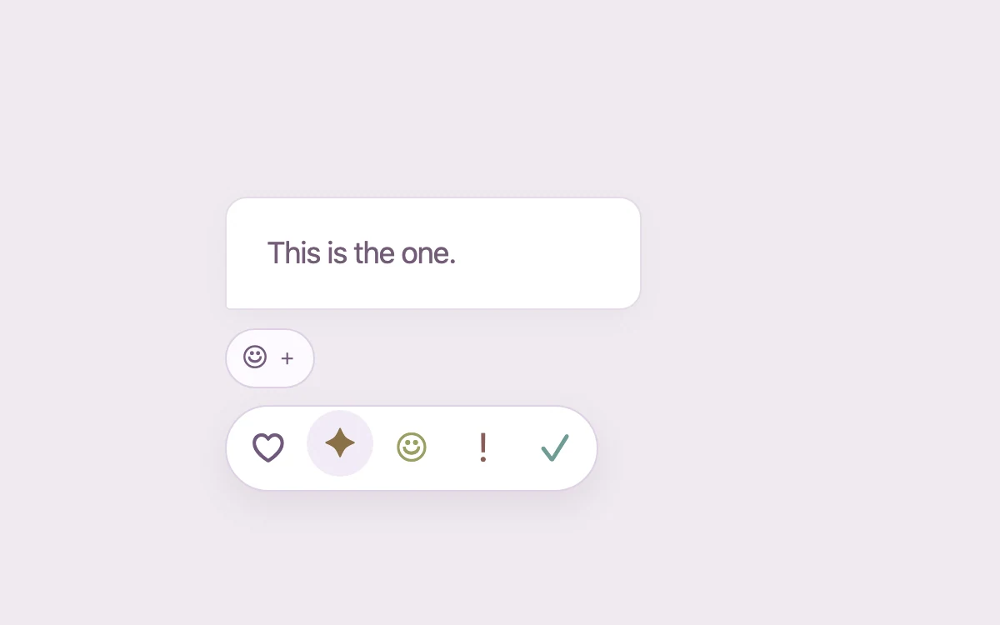

# Reaction palette

> Choose a reaction without covering the message being discussed.

- **Common name:** Emoji reaction picker
- **Category:** Components & interactions
- **Live demo:** https://www.subframe.com/motion/reaction-palette
- **Source:** Subframe (original, MIT)
- **Dependencies:** none

## Use case

Choose a reaction without covering the message being discussed.

## Interaction

Choose a reaction

## Look

Pale lilac background with a white chat bubble, a small pill reaction button and a white rounded pill of five muted-colour typographic symbols.

## Motion

Clicking fades in the palette as it settles from 96% scale and 5 px up in 180 ms; symbols rise in 18 ms apart and lift 3 px on hover.

## How to adapt

The open state is `reaction-options` toggled by `data-open` (opacity plus translate and scale, 180 ms), with per-button `transitionDelay` of `i * 18` ms. Replace `reactions`, `labels` and the `quote` bubble; keep the `inert` popover and focus return to `trigger`.

## Reduced motion

Live system preference disables decorative motion; all controls remain usable. Keyboard actions settle immediately.

## Limitations

Original typographic reaction symbols, not an emoji asset set. Selection remains local.

## Taxonomy

- **Components:** picker, tooltip
- **Triggers:** press, hover
- **Techniques:** scale, fade, stagger, slide
- **Feel:** subtle
- **Contexts:** app
- **Tags:** reaction, palette, popover, message, feedback
- **Also known as:** message reactions, reaction bar, emoji popover, react to message
- **Surface color:** `#edf0f3`

## Code

See [`component.tsx`](component.tsx).
