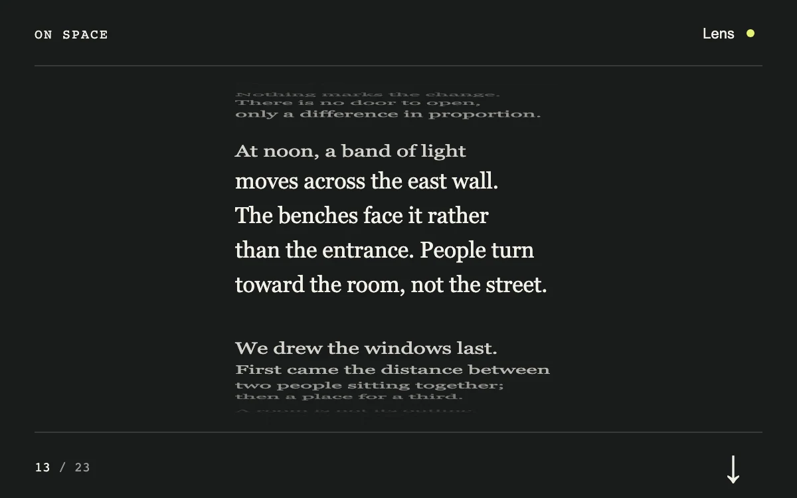

# Reading lens

> A native scrolling note preserves a readable center while compressing peripheral lines.

- **Common name:** Fisheye scroll text
- **Category:** Animation & motion
- **Live demo:** https://www.subframe.com/motion/reading-lens
- **Source:** Subframe (original, MIT)
- **Dependencies:** none

## Use case

Keep neighboring passages in view around a focused reading region.

## Interaction

Scroll or advance a passage.

## Look

Near-black page with a centred column of cream serif lines that flatten and dim toward the edges, monospace header and counter, and hairline rules.

## Motion

Native scrolling re-maps every line: the five nearest the centre stay full size, farther lines squash vertically and fade with exponential falloff; the arrow smooth-scrolls six lines.

## How to adapt

The fisheye mapping is `update` in the effect keyed on `lens` and `reduced`: lines with `a <= 2` stay full size, then offset and `scaleY` decay exponentially (rate `0.32`). Replace the pre-broken `lines`, which assume a fixed `26` px line height.

## Reduced motion

The note becomes an ordinary native scrolling text column with no compression or animated scrolling.

## Limitations

The authored line breaks use a fixed 26 px line height. Adapt the mapping for arbitrary wrapping text.

## Taxonomy

- **Components:** text
- **Triggers:** scroll
- **Techniques:** distortion, scale, fade
- **Feel:** refined, calm
- **Contexts:** editorial
- **Tags:** scroll, fisheye, typography, focus, native scroll
- **Also known as:** fisheye list, magnified scroll text, focus reading mode, teleprompter scroll
- **Surface color:** `#191b1b`

## Code

See [`component.tsx`](component.tsx).
