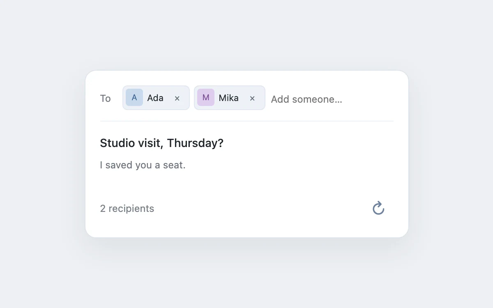

# Recipient tokens

> Turn addresses into removable recipients without breaking typing flow.

- **Common name:** Recipient chips input
- **Category:** Components & interactions
- **Live demo:** https://www.subframe.com/motion/recipient-tokens
- **Source:** Subframe (original, MIT)
- **Dependencies:** none

## Use case

Turn addresses into removable recipients without breaking typing flow.

## Interaction

Add or remove a recipient

## Look

Pale blue-grey page with a white rounded compose card: pale recipient chips with pastel initial avatars and remove crosses, a bold subject and grey body.

## Motion

A committed recipient becomes a token that fades and scales in from 0.92 over 160 ms ease-out; removal has no exit animation, and keyboard-driven commits skip the entrance.

## How to adapt

Tokens enter with the `sf-recipient-tokens-recipientIn` keyframe (160ms ease-out on `.token`); `insert` trims, dedupes and caps at five, and Backspace on an empty field removes the last. Replace the `names` seed and add real address validation.

## Reduced motion

Live system preference disables decorative motion; all controls remain usable. Keyboard actions settle immediately.

## Limitations

Accepts display names, not email validation; up to five recipients. No message is sent.

## Taxonomy

- **Components:** input
- **Triggers:** enter, keyboard, press
- **Techniques:** scale, fade
- **Feel:** subtle
- **Contexts:** app
- **Tags:** tokens, recipient, input, tags, keyboard
- **Also known as:** tag input, email to field, multi-value token field, removable chips
- **Surface color:** `#edf0f3`

## Code

See [`component.tsx`](component.tsx).
