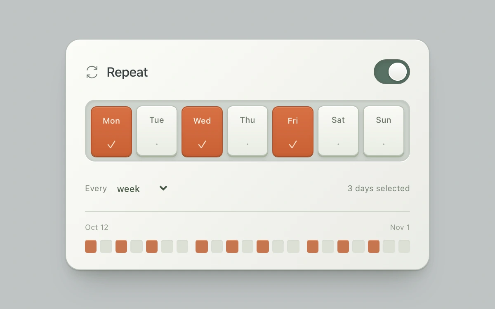

# Recurrence picker

> Pressed day keys author a weekly rule and illuminate its next three weeks.

- **Common name:** Weekly recurrence picker
- **Category:** Components & interactions
- **Live demo:** https://www.subframe.com/motion/recurrence-picker
- **Source:** Subframe (original, MIT)
- **Dependencies:** none

## Use case

Configure a repeat schedule with a compact preview of the dates it will affect.

## Interaction

Select weekdays, choose a weekly interval and toggle repeating. The 21-day strip follows the rule.

## Look

Off-white card on cool grey: sage switch, a recessed tray of raised day keys with selected ones burnt orange, and a row of date tiles.

## Motion

Pressed day keys sink 3 px and settle 1 px low in orange (160 ms ease-out); the switch thumb slides in 180 ms; matching date tiles recolour in 150 ms.

## How to adapt

Selection state is `days`, `interval` and `enabled`, and the 21 `.occurrences` tiles derive `data-on` from them; press depth and timing are the `.days button` rules in the inline style. Replace `DAYS`, the hard-coded start date and the summary text with your scheduler.

## Reduced motion

Finite transitions become immediate under reduced motion and keyboard input. Host pause disables controls; any owned drag is cancelled.

## Limitations

Local illustrative schedule anchored to Monday, October 12, 2026; no timezone, DST or recurrence-service integration. Empty day sets are allowed with an explicit accessible prompt.

## Taxonomy

- **Components:** picker, toggle
- **Triggers:** press, state
- **Techniques:** slide, gradient
- **Feel:** subtle, refined
- **Contexts:** app
- **Tags:** schedule, recurrence, weekdays, toggle, multi-select, calendar, pressed-state, tactile
- **Also known as:** repeat schedule settings, weekday selector, day of week toggles, recurring event rule, calendar repeat picker
- **Surface color:** `#bfc4c5`

## Code

See [`component.tsx`](component.tsx).
