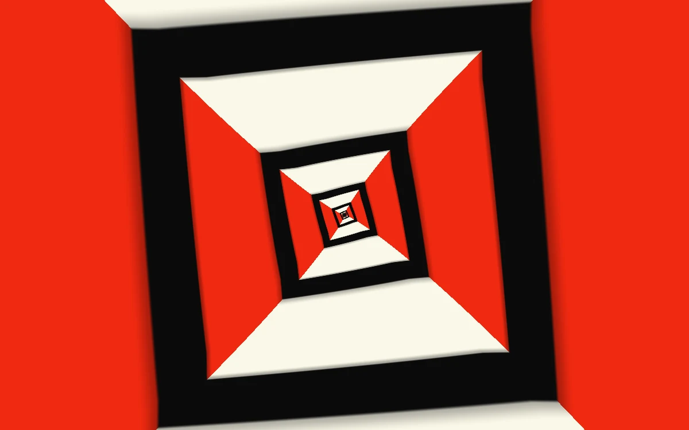

# Recursive aperture

> Vermilion and ivory frames fold into a continuous recursive aperture.

- **Common name:** Infinite zoom shader
- **Category:** WebGL & shaders
- **Live demo:** https://www.subframe.com/motion/recursive-aperture
- **Source:** Subframe (original, MIT)
- **Dependencies:** none

## Use case

Build an infinite image-space zoom with controllable angular coupling.

## Interaction

Adjust twist.

## Look

Op-art tunnel of nested square frames with vermilion side and ivory top-and-bottom trapezoids, thick black bands between them, receding to a centre point.

## Motion

Frames expand outward from the centre in a seamless logarithmic zoom, one 2.7× layer roughly every 9 s; the twist slider rotates each layer in proportion to depth, either direction.

## How to adapt

The `FRAGMENT` shader maps each pixel to log depth (`log(2.7)` per frame, `u_time*.11` speed) and twists with `rot((u_control-.5)*.7*depth)`; `edge` and `bevel` shape the black bands. Recolour `red`, `paper` and `black`; keep the context-loss and reduced-motion handling.

## Reduced motion

The elapsed-time clock stops. Parameter controls immediately update the static composition.

## Limitations

Requires WebGL 1; a static CSS swatch appears if unavailable or after context loss. A procedural coordinate-space recursion, not nested DOM or a navigable 3D tunnel.

## Taxonomy

- **Components:** background
- **Triggers:** ambient, state
- **Techniques:** shader, loop, scale, rotate
- **Feel:** bold
- **Contexts:** landing, editorial
- **Tags:** native webgl, droste, recursive, log polar, infinite zoom, aperture
- **Also known as:** Droste effect, endless square tunnel, recursive frame zoom, op-art tunnel background
- **Surface color:** `#ed3c25`

## Code

See [`component.tsx`](component.tsx).
