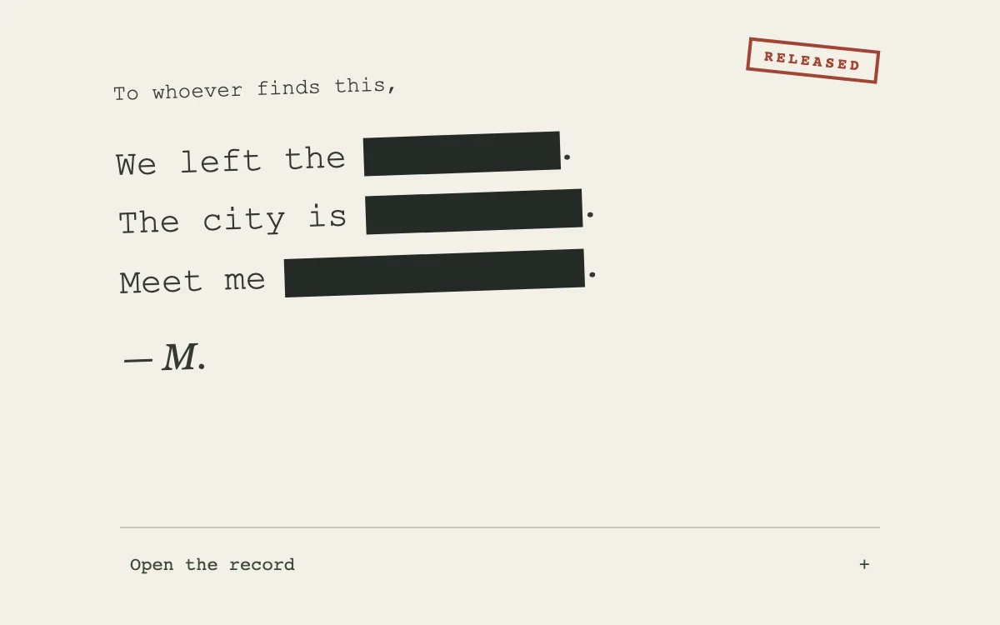

# On the record

> Heavy redaction bars retract to reveal a short archival note.

- **Common name:** Redacted text reveal
- **Category:** Animation & motion
- **Live demo:** https://www.subframe.com/motion/redaction-reveal
- **Source:** Subframe (original, MIT)
- **Dependencies:** none

## Use case

Stage a deliberate disclosure in an editorial story or reveal hidden product details.

## Interaction

Reveal or redact the note

## Look

Cream paper with a slightly rotated typewriter-style monospace note, three phrases covered by heavy black redaction bars, a red rubber stamp and italic serif signature.

## Motion

Pressing the toggle retracts each black bar toward its left edge with scaleX over 0.55 s ease-out, staggered 60 ms per phrase; pressing again extends them back over the text.

## How to adapt

Each bar is the `.note span:after` pseudo-element, collapsing via `scaleX(0)` from `transform-origin:left` over 0.55 s `cubic-bezier(.25,.8,.3,1)` when `data-open` flips, with `nth-of-type` delays. Wrap your phrases in `span` elements inside `note` and drive `open`.

## Reduced motion

Live reduced-motion preferences remove interpolation and decorative playback. All content and native controls remain available. Keyboard changes settle immediately.

## Limitations

Original demonstration content; adapt labels and state to the host product.

## Taxonomy

- **Components:** text
- **Triggers:** press
- **Techniques:** mask, scale, stagger
- **Feel:** refined
- **Contexts:** editorial, landing
- **Tags:** text, mask, reveal, redaction, editorial
- **Also known as:** censored text reveal, blackout text, spoiler reveal, hidden text wipe, classified document reveal
- **Surface color:** `#f2f0e6`

## Code

See [`component.tsx`](component.tsx).
