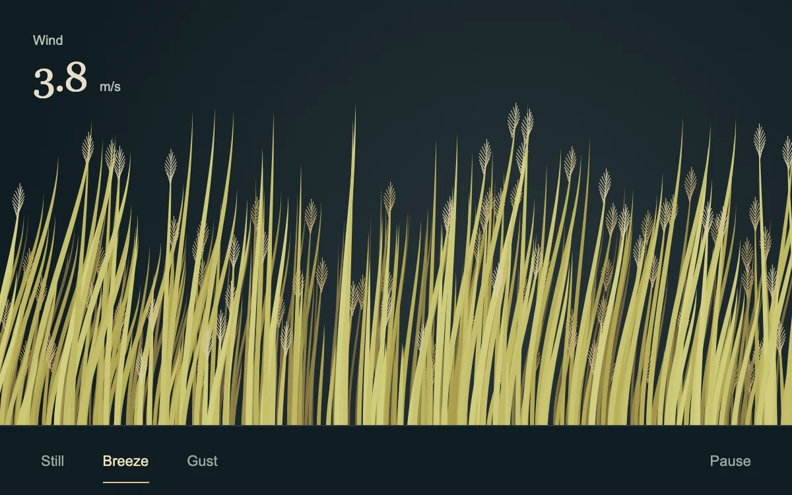

# Reed field

> Fine gold stems bend in layered wind and part around a passing pointer.

- **Common name:** Interactive grass animation
- **Category:** Animation & motion
- **Live demo:** https://www.subframe.com/motion/reed-field
- **Source:** Subframe (original, MIT)
- **Dependencies:** none

## Use case

Add a small interactive natural surface to a botanical, landscape or material story.

## Interaction

Brush across the reeds or change the wind strength

## Look

Dark slate-teal backdrop with dense, layered gold and olive reed blades topped by feathery seed heads, a large serif wind readout and minimal text controls.

## Motion

Reeds sway continuously, each springing toward a two-sine breeze angle scaled by the still, breeze or gust setting; stems within 105 px of the pointer bend away from it.

## How to adapt

Per-stem motion is in `draw`: `breeze` sets each target angle, the `[0.15, 1, 2.8]` wind multipliers scale it, a 105 px pointer push adds parting, and a spring (stiffness 75, damping 10) moves `stem.angle`. Stems are generated in `updateSize`; recolour the `hsl` fills.

## Reduced motion

A single posed field replaces continuous wind and pointer motion. Wind controls select static poses.

## Limitations

Canvas2D, capped at 480 stems and 2× display pixel ratio. Decorative illustration, not a physical vegetation simulation. Pause and document hiding stop the frame loop.

## Taxonomy

- **Components:** background, scene
- **Triggers:** ambient, pointer
- **Techniques:** canvas, spring, physics
- **Feel:** calm, playful
- **Contexts:** editorial, landing
- **Tags:** grass, reeds, wind, canvas, botanical, spring, pointer, field
- **Also known as:** wind blown grass, swaying wheat field, interactive meadow, pointer parting grass
- **Surface color:** `#101c22`

## Code

See [`component.tsx`](component.tsx).
