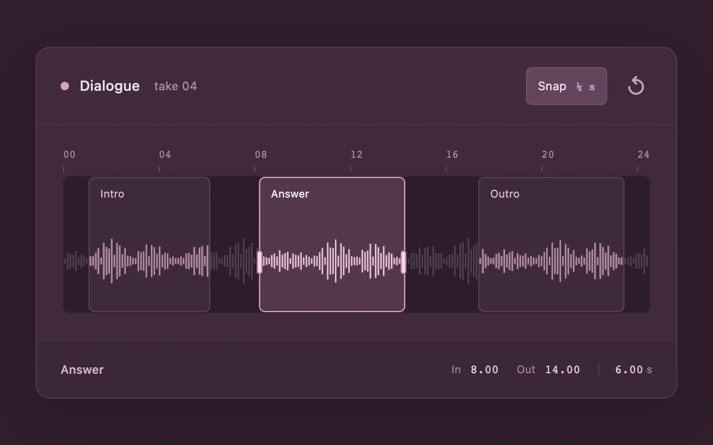

# Region splice

> Three waveform selections move and resize within shared bounds without colliding.

- **Common name:** Waveform region selector
- **Category:** Components & interactions
- **Live demo:** https://www.subframe.com/motion/region-splice
- **Source:** Subframe (original, MIT)
- **Dependencies:** none

## Use case

Mark several passages in one recording while maintaining minimum durations and separation.

## Interaction

Drag a region or its selected edges; use arrows, Shift, Home and End; toggle quarter-second snapping or reset.

## Look

Dark plum audio editor card with a pink waveform track, three translucent rounded region boxes (one highlighted with edge handles), monospace ruler and timing readouts.

## Motion

Dragging a region or edge handle moves or resizes it 1:1 with the pointer, stopping at neighbours and a 4 s minimum, optionally snapping to 0.25 s; no easing.

## How to adapt

`shiftRegion` enforces bounds using `GAP`, `MINIMUM` and `LENGTH`; `start`, `move` and `end` handle pointer capture, snapping to quarter seconds when `snap` is on, and `key` maps arrows, Home and End. Replace `INITIAL` and the synthetic `PEAKS` waveform with decoded audio peaks.

## Reduced motion

Editing tracks the pointer directly, without inertial or decorative animation.

## Limitations

Deterministic synthetic waveform and three local selection regions. No audio decoding, playback, export or destructive clip edits.

## Taxonomy

- **Components:** editor, media
- **Triggers:** drag, keyboard
- **Techniques:** slide
- **Feel:** technical
- **Contexts:** app
- **Tags:** audio, waveform, timeline, multi-region, resize, collision, pointer-capture, keyboard
- **Also known as:** audio trimmer, waveform clip editor, audio range selection, multi-range slider, timeline region editor
- **Surface color:** `#311d2c`

## Code

See [`component.tsx`](component.tsx).
